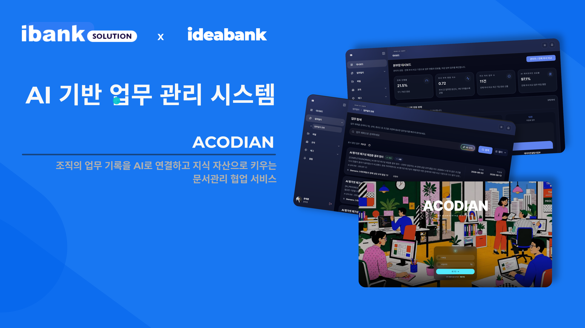
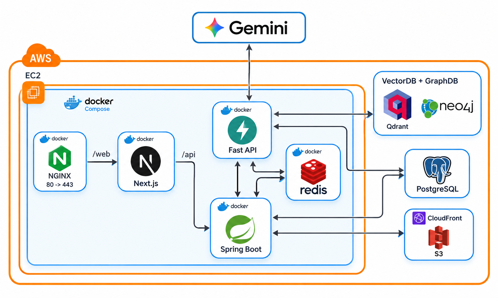
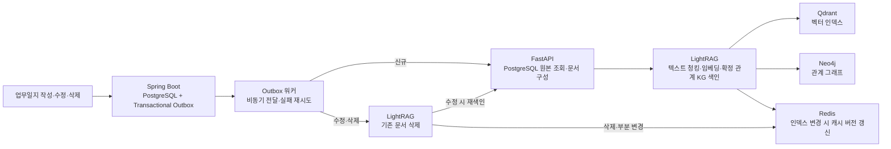
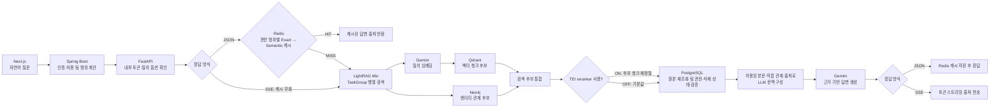

# ACODIAN — RAG AI Backend

## 프로젝트

**ACODIAN(AX-WMS)**은 본부·사업부·팀 단위의 업무일지를 관리하고, 축적된 기록을 자연어로 검색해 관련 근거와 답변을 제공하는 웹 서비스입니다. Next.js UI, Spring Boot API, FastAPI AI 서비스로 구성됩니다.

RAG 질의에서는 LightRAG가 Qdrant 벡터 검색과 Neo4j 관계 탐색을 결합하고, PostgreSQL 원본에서 접근 권한을 확인한 문서만 Gemini 답변의 근거로 사용합니다.

- **담당 범위:** RAG 질의·평가, 권한별 캐시, 증분 재색인 및 Spring Boot 연동
- **주요 기술:** Python · FastAPI · LightRAG · Qdrant · Neo4j · PostgreSQL · Redis · Gemini · Spring Boot · Docker

## 시스템 구조

### 전체 시스템 아키텍처

### 업무일지 색인·갱신 흐름

수정은 기존 문서를 삭제한 뒤 최신 원본을 재색인합니다. Outbox는 비동기이므로 DB 변경부터 재색인·캐시 버전 갱신까지 즉시 일치하지 않는 구간이 있습니다.

### RAG 질의·답변 흐름

권한 제한 질의 기준입니다. **리랭커는 검색 후보 청크에 적용한 뒤** PostgreSQL 원본 권한 검증을 거치며, 검증되지 않은 인덱스 내용은 LLM 문맥에 넣지 않습니다. TEI 리랭킹은 선택 기능으로 기본 비활성화되어 있습니다. Redis 응답 캐시는 JSON 질의에만 사용하고 SSE 질의는 캐시를 우회합니다.

## 개인 기여 요약

| 문제 | 구현과 결과 | PR |
| --- | --- | --- |
| 검색·생성 지연 | Qdrant·Neo4j 검색 병렬화, SSE 스트리밍. **로컬 단일 질의 `v4-033`** 완료 시간 **8.30초 → 4.00초**, 첫 응답 **8.30초 → 2.45초** | [#12](https://github.com/sunghun0917/acodian/pull/12) |
| 팀 간 데이터 노출 위험 | PostgreSQL 원본 권한 재검증 후 LLM 문맥 구성, 권한 범위별 Redis 캐시 | [#13](https://github.com/sunghun0917/acodian/pull/13), [#21](https://github.com/sunghun0917/acodian/pull/21) |
| 수정·삭제 후 과거 답변 반환 | 단일 문서 증분 재색인, Transactional Outbox, Redis 버전 무효화. 무효화 요청 **39.96ms → 2.54ms** | [#14](https://github.com/sunghun0917/acodian/pull/14) |
| RAG 품질 검증 부재 | Naive/Mix 비교 벤치마크 V1~V4, RAGAS 평가, 선택적 리랭킹 | [#7](https://github.com/sunghun0917/acodian/pull/7), [#8](https://github.com/sunghun0917/acodian/pull/8), [#10](https://github.com/sunghun0917/acodian/pull/10) |

## 구현 상세와 근거

### 1. 검색 병렬화 · SSE 스트리밍

- **문제:** LightRAG Mix 모드에서 벡터 검색과 그래프 탐색이 직렬 대기하고, LLM 생성이 끝날 때까지 응답이 보이지 않았습니다.
- **선택·구현:** 서로 독립적인 그래프·벡터 조회를 `asyncio.TaskGroup`으로 병렬화하고 임베딩을 벡터 검색 태스크 안으로 이동했습니다. 조회 태스크에 예외가 발생하면 나머지 태스크도 취소하는 수명주기 관리가 선택 이유입니다. 별도 FastAPI SSE 엔드포인트에는 전체 데드라인과 클라이언트 연결 해제 처리를 적용했습니다.
- **결과:** V4 단일 질의 `v4-033` 로컬 측정에서 완료 시간 **8,295ms → 4,004ms(51.7%↓)**, 첫 응답 시간 **8,295ms → 2,450ms(70.5%↓)**. 전체 트래픽의 지연 분포를 뜻하는 수치는 아닙니다.
- **코드:** [병렬 검색 커밋](https://github.com/sunghun0917/acodian/commit/7b2e16a8) · [SSE 커밋](https://github.com/sunghun0917/acodian/commit/ed97985a) · [PR #12](https://github.com/sunghun0917/acodian/pull/12) · [측정 보고서](docs/ai/report/rag-optimization-and-evaluation-report.md)

### 2. 원본 권한 검증 · 2단계 캐시

- **문제:** 여러 팀의 문서가 섞인 인덱스의 검색 결과를 그대로 LLM에 전달하면 권한 밖 업무일지가 노출될 수 있고, 반복 질의마다 검색·생성 비용이 발생했습니다.
- **구현:** 검색 후보를 PostgreSQL 원본에서 다시 조회해 팀 권한과 삭제 상태를 확인했습니다. 검증된 본문만 LLM 문맥에 사용하고, 권한 범위별 Redis Exact/Semantic 캐시와 Redis 장애 폴백을 추가했습니다.
- **검증:** 보안 시나리오 5종을 검증했습니다. 실제 Gemini 질문 임베딩을 포함한 로컬 FastAPI HTTP 측정에서 **각 10회 중앙값**은 Exact HIT **2.338ms**, Semantic HIT **388.203ms**였습니다. Spring API를 포함한 사용자 E2E·운영 SLA는 아닙니다.
- **코드:** [권한·캐시 커밋](https://github.com/sunghun0917/acodian/commit/e4659f39) · [PR #13](https://github.com/sunghun0917/acodian/pull/13) · [실임베딩 측정 커밋](https://github.com/sunghun0917/acodian/commit/6938ff21) · [PR #20](https://github.com/sunghun0917/acodian/pull/20) · [원시 표본](docs/ai/report/semantic-cache-real-embedding-raw.json)

### 3. 증분 재색인 · 캐시 최신성

- **문제:** 업무일지 수정·삭제 후에도 LightRAG 인덱스와 Redis에 이전 내용이 남아 과거 답변이 반환될 수 있었습니다.
- **선택·구현:** 전체 인덱스 재구축 대신 LightRAG의 단일 문서 삭제·재색인을 사용했습니다. 업무일지 변경과 같은 DB 트랜잭션에 Outbox를 기록하고, 워커가 실패 작업을 지수 백오프로 재시도합니다. AI에서 문서 삭제·삽입 등 부분 변경이 발생해도 Redis 글로벌 버전을 `INCR`해 기존 캐시를 무효화합니다.
- **결과:** 1,000건 데이터 조건의 로컬 HTTP 벤치마크에서 무효화 요청은 `SCAN+DEL` **39.96ms** 대비 `INCR` **2.54ms**였습니다. 글로벌 버전은 빠르지만 한 문서 변경에도 전체 캐시가 무효화되는 비용이 있습니다.
- **정합성 범위:** Outbox는 비동기 최종 일관성 방식입니다. DB 커밋부터 워커 반영·캐시 버전 갱신까지는 새 내용이 검색되지 않거나 이전 캐시가 반환될 수 있으므로 즉시 일관성을 보장하지 않습니다.
- **코드:** [증분 재색인 커밋](https://github.com/sunghun0917/acodian/commit/a68fab56) · [부분 실패 방어 커밋](https://github.com/sunghun0917/acodian/commit/23eb59d7) · [PR #14](https://github.com/sunghun0917/acodian/pull/14) · [기술 보고서](docs/ai/report/worklog-rag-cache-and-reindex-report.md)

### 4. RAG 평가 · 선택적 리랭킹

- **평가 기반:** 합성 업무일지 **200건·50문항**의 V1 코퍼스와 검증기·실행기를 만들고, 관계 복잡도별 V2 **80문항**, ID 없는 자연어 질문 V3 **50문항**, 기준답변을 보완한 V4로 확장했습니다. ([평가 커밋](https://github.com/sunghun0917/acodian/commit/54ad566f), [PR #7](https://github.com/sunghun0917/acodian/pull/7), [V3 커밋](https://github.com/sunghun0917/acodian/commit/7993e5a2), [PR #8](https://github.com/sunghun0917/acodian/pull/8))
- **리랭킹 실험:** TEI 리랭커를 선택적으로 연동했습니다. V4 Main Overall **44문항**에서 Answer Relevancy **0.8316 → 0.8496**, Context Recall **0.6307 → 0.6572**였지만 Faithfulness는 **0.9396 → 0.8920**으로 하락했습니다. 로컬 CPU 환경의 Mix **50문항**에서는 평균 검색 시간이 약 **104.51초**였고, 답변 캐시는 꺼져 있었습니다. 품질 이득보다 충실도·지연 비용이 커 기본 경로에서는 비활성화했습니다. ([구현 커밋](https://github.com/sunghun0917/acodian/commit/a394e2f7), [PR #10](https://github.com/sunghun0917/acodian/pull/10), [평가 결과](docs/ai/evaluation/v4/results-ragas-reranker-v4-mix-only-20260930/report.md))

### 5. 권한 검증된 직접 의존관계 문맥

- **문제:** 권한 제한 RAG가 업무 본문만 LLM에 전달해 직접 선행업무 관계·작성자에 대한 질문에 답하기 어려웠습니다.
- **구현:** 양쪽 업무의 접근 권한을 확인한 **직접 관계**만 작성자·팀·태그와 함께 문맥에 추가했습니다. 확장량·문맥 크기에 상한을 적용하고 기존 캐시와 네임스페이스를 분리했습니다. 다중 홉·역방향 탐색은 포함하지 않았습니다.
- **코드:** [관계 문맥 커밋](https://github.com/sunghun0917/acodian/commit/467d68d0) · [캐시 분리 커밋](https://github.com/sunghun0917/acodian/commit/091f7869) · [PR #21](https://github.com/sunghun0917/acodian/pull/21)

## 검증

- AI 테스트: [환경 준비](ai/AGENTS.md) 후 `cd ai && python -m pytest tests -q` — 2026-10-12 로컬 실행 결과 **209 passed**. 이 결과는 `ai/tests/` 범위이며 실제 Gemini/Redis HTTP 벤치마크나 Spring API E2E를 대체하지 않습니다.
- 성능·품질 실험의 환경, 원시 결과, 한계: [RAG 응답 시간 보고서](docs/ai/report/rag-optimization-and-evaluation-report.md) · [RAG 평가 자료](docs/ai/evaluation/) · [실임베딩 캐시 측정](docs/ai/report/semantic-cache-real-embedding-benchmark.md) · [재색인·무효화 보고서](docs/ai/report/worklog-rag-cache-and-reindex-report.md)
