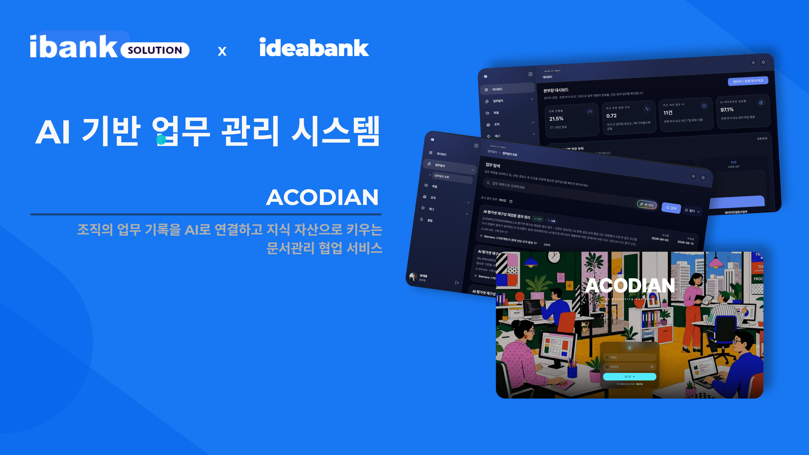
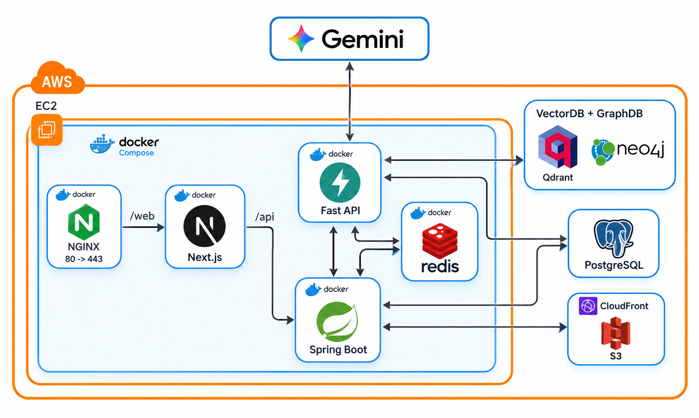
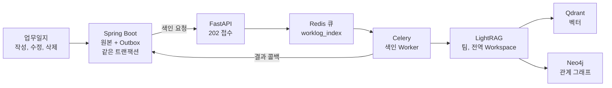
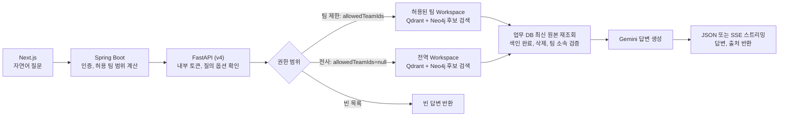

# ACODIAN — RAG AI Backend

> 팀 업무일지를 자연어로 검색하고 답하는 **RAG AI 백엔드(FastAPI, LightRAG)**를 맡았습니다. 팀별 권한 격리, 비동기 색인, RAG 평가 파이프라인을 구현했고, 단일 질의 응답 완료 시간을 8.30초에서 4.00초로 줄였습니다.

## 📌 프로젝트 소개

**ACODIAN(AX-WMS)**은 본부, 사업부, 팀 단위의 업무일지를 관리하고, 축적된 기록을 자연어로 검색해 신뢰할 수 있는 근거와 답변을 제공하는 지능형 업무 관리 시스템입니다. **Next.js UI**, **Spring Boot API**, **FastAPI AI 서비스**의 3-Tier 모노레포 아키텍처로 구성되어 있습니다.

RAG 질의 파이프라인은 **LightRAG**의 **Qdrant 벡터 검색**과 **Neo4j 지식 그래프 탐색**을 사용합니다. 현재 v4의 팀 제한 질의는 인가된 팀별 전용 Workspace에서, 전사 질의(`allowedTeamIds=null`)는 전역 Workspace에서 후보를 찾습니다. 두 경우 모두 답변 생성 전에 업무 DB(PostgreSQL)에서 최신 원본과 권한을 다시 확인해 문맥을 구성합니다.

> **v3 / v4**: v3는 초기 구현(전역 검색 후 권한 필터), v4는 현재 구현(팀별 검색 공간)입니다. **Workspace**는 LightRAG의 데이터 분리 단위입니다. 자세한 비교는 [v3 → v4 변경점](#v3--v4-변경점)을 봅니다.

- **담당 범위**: RAG 검색, 권한 격리(v3 → v4) / 증분 재색인과 비동기 색인(Outbox, Celery) / AI 후처리 신뢰성 / RAG 평가 / Spring Boot 연동
- **주요 기술**: `Python`, `FastAPI`, `LightRAG`, `Qdrant`, `Neo4j`, `PostgreSQL`, `Redis`, `Gemini`, `Spring Boot`, `Docker`

---

## 🚀 개인 기여 요약

| 문제 | 해결 방안과 결과 | 관련 PR |
| :--- | :--- | :---: |
| **검색, 생성 지연** | • Qdrant, Neo4j 검색 병렬화와 SSE 스트리밍 • 로컬 단일 질의(`v4-033`) 기준 **완료 8.30초 → 4.00초 (51.7%↓)**, **첫 응답 8.30초 → 2.45초 (70.5%↓)** | [#12](https://github.com/sunghun0917/acodian/pull/12) |
| **팀 간 데이터 노출 위험** | • v3: 전역 검색 후 업무 DB 원본으로 권한 재검증, 권한 범위별 Redis 2단계(Exact/Semantic) 캐시 • v4: **팀별 LightRAG Workspace**로 검색 단계부터 격리, 권한 확인된 직접 선행 관계만 문맥에 추가 | [#13](https://github.com/sunghun0917/acodian/pull/13) [#21](https://github.com/sunghun0917/acodian/pull/21) [#26](https://github.com/sunghun0917/acodian/pull/26) |
| **수정, 삭제 후 과거 답변 반환** | • 단일 문서 증분 재색인, v3 캐시의 Redis 버전 무효화 (**무효화 지연 39.96ms → 2.54ms**) • 부분 실패 시 이번에 쓴 데이터만 되돌리는 보상 삭제, 전역/팀 색인이 모두 끝나야 검색에 노출하는 완료 게이트 | [#14](https://github.com/sunghun0917/acodian/pull/14) [#39](https://github.com/sunghun0917/acodian/pull/39) |
| **색인 대기로 요청이 묶이고 유실됨** | • 등록과 색인 요청을 같은 트랜잭션에 기록하는 Transactional Outbox • 동기 HTTP 색인(수십 초~수 분)을 **202 접수 + Celery 실행 + 결과 콜백**으로 전환, 일반 AI 작업과 색인 Worker 분리 • 늦게 도착한 옛 결과가 최신 색인을 덮지 않게 차단 | [#32](https://github.com/sunghun0917/acodian/pull/32) [#40](https://github.com/sunghun0917/acodian/pull/40) [#43](https://github.com/sunghun0917/acodian/pull/43) [#44](https://github.com/sunghun0917/acodian/pull/44) |
| **AI 후처리 실패를 알 수 없음** | • 요약, 태그, 파일 요약을 작업별 Outbox로 분리하고 작업별 결과 알림, 실패 작업 수동 재시도 추가 | [#46](https://github.com/sunghun0917/acodian/pull/46) [#47](https://github.com/sunghun0917/acodian/pull/47) |
| **RAG 품질 검증 부재** | • RAGAS 3대 지표 기반 평가 파이프라인(V1~V4) • Naive vs Mix, 선택적 리랭킹 영향 분석 | [#8](https://github.com/sunghun0917/acodian/pull/8) [#10](https://github.com/sunghun0917/acodian/pull/10) [#27](https://github.com/sunghun0917/acodian/pull/27) |

**그 밖의 기여**
- LightRAG 저장소를 JSON 파일에서 전용 PostgreSQL DB로 전환 ([#35](https://github.com/sunghun0917/acodian/pull/35))
- Langfuse 요청 추적 ([#28](https://github.com/sunghun0917/acodian/pull/28))
- 선행 업무 등록 경쟁 조건을 낙관적 락으로 방지 ([#19](https://github.com/sunghun0917/acodian/pull/19))
- OpenAI 기반 PR 리뷰 봇 ([#1](https://github.com/sunghun0917/acodian/pull/1))

---

## 🏗️ 시스템 구조

### 전체 시스템 아키텍처

---

### 업무일지 색인, 갱신 흐름

> [!NOTE]
> - **전달과 실행 분리**: Spring Outbox는 AI 서버의 접수(202)까지만 책임지고, 실제 색인은 일반 AI 작업과 분리된 Celery 색인 Worker가 실행합니다. 색인과 AI 작업 모두 최종 실패하면 사용자가 수동으로 재시도할 수 있습니다.
> - **수정, 삭제**: 수정은 기존 문서를 지운 뒤 업무 DB의 최신 원본으로 다시 색인합니다. 중간에 실패하면 새로 쓴 부분만 정리하고, 해당 업무일지는 재시도 전까지 검색에서 빠집니다.
> - **일시적 불일치**: 비동기 처리라 저장 직후에는 새 내용이 바로 검색되지 않을 수 있습니다. 색인이 끝나지 않은 문서는 검색 결과에 나오지 않습니다.

---

### RAG 질의, 답변 흐름 (v4)

> [!IMPORTANT]
> **v4 RAG 질의 파이프라인의 핵심 규칙**:
> 1. **팀 범위 격리**: 팀 제한 질의는 인가된 팀 ID에 해당하는 전용 Workspace에서 검색합니다. 전사 질의(`allowedTeamIds=null`)만 전역 Workspace를 사용합니다.
> 2. **최신 원본 문맥 구성**: LightRAG 검색 결과에서는 후보 업무 ID만 사용합니다. 전사, 팀 제한, JSON, SSE 모두 같은 경로로 업무 DB(PostgreSQL)에서 최신 원본을 다시 읽고, 색인 완료 여부, 삭제 여부, 팀 소속을 확인한 업무만 LLM 문맥에 넣습니다.
> 3. **선택적 리랭킹**: TEI 리랭커는 설정 시 후보를 재정렬하며 기본값은 OFF입니다.

---

### v3 → v4 변경점

v3는 **한 곳에서 다 검색한 뒤 권한으로 걸러내는** 구조였고, v4는 **팀마다 검색 공간을 나눠 처음부터 허용된 범위만 검색**합니다. 색인도 요청 자리에서 바로 하던 방식에서 접수 후 백그라운드 실행으로 바뀌었습니다. v3 코드는 2026-11-13에 삭제했습니다.

| 구분 | v3 | v4 (현재) |
| :--- | :--- | :--- |
| 권한 처리 | 전역 Workspace 하나에서 검색 후 권한 필터(사후 필터) | **팀별 Workspace**에서 검색(사전 격리), 전사 권한만 전역 Workspace |
| 문맥 구성 | 업무 DB 원본 재조회로 권한, 삭제 확인 | 같은 원칙 + 색인 완료 여부, 색인 당시 팀(팀 이동 후 옛 색인 차단)까지 확인 |
| 색인 실행 | HTTP 요청 안에서 동기 색인 | **202 접수 → Celery Worker 실행 → 결과 콜백** |
| 부분 실패 | 재색인 중 삭제 실패만 방어 | 이번에 쓴 데이터만 되돌리는 보상 삭제, 완료 게이트(STAGING → COMPLETED) |
| LightRAG KV, 문서 상태 | 로컬 JSON 파일 | 전용 PostgreSQL DB(업무 DB와 분리), 벡터는 Qdrant, 그래프는 Neo4j |
| 보안, 관측 | 내부 인증과 추적 없음 | 내부 토큰 인증, 업무일지 단위 잠금, Langfuse 추적 |

> 자세한 비교: [v3 → v4 변경 기록](docs/ai/report/lightrag-v4/v3-v4-differences.md)

---

## 🛠️ 구현 상세와 엔지니어링 근거

### 1. 검색 병렬화, SSE 스트리밍

- **문제 배경**:
  - LightRAG Mix 모드에서 벡터 검색과 그래프 탐색이 직렬로 대기하여 불필요한 대기 지연이 발생함.
  - LLM 생성이 완료될 때까지 사용자가 아무런 응답을 볼 수 없어 체감 지연(TTFT)이 심각함.
- **선택 및 구현**:
  - 상호 독립적인 그래프, 벡터 조회를 `asyncio.TaskGroup`으로 묶어 병렬 실행하고, 임베딩 연산을 벡터 검색 태스크 내부로 이동.
  - 한쪽 태스크 예외 발생 시 나머지 태스크를 즉시 취소하는 안전한 수명주기 관리 보장.
  - 별도 FastAPI SSE 엔드포인트를 구현하고, 전체 요청 데드라인 및 클라이언트 연결 해제 핸들링 적용.
- **정량적 결과**:
  - V4 단일 질의 `v4-033` 로컬 측정 기준:
    - **전체 완료 시간**: `8,295ms` → **`4,004ms` (51.7% 감소)**
    - **첫 응답 시간 (TTFT)**: `8,295ms` → **`2,450ms` (70.5% 감소)**
    - *(※ 전체 트래픽의 지연 분포를 나타내는 수치는 아닙니다.)*
- **관련 코드 및 산출물**:
  - [병렬 검색 커밋](https://github.com/sunghun0917/acodian/commit/7b2e16a8), [SSE 커밋](https://github.com/sunghun0917/acodian/commit/ed97985a), [PR #12](https://github.com/sunghun0917/acodian/pull/12), [측정 보고서](docs/ai/report/rag-evaluation/speed-and-ragas-report.md)

---

### 2. 권한 격리 (v3: 원본 재검증, 2단계 캐시 → v4: 팀별 Workspace)

> 아래 측정은 v3 당시 구현 기준입니다. v4에서 바뀐 점은 [v3 → v4](#v3--v4-변경점)를 봅니다.

- **문제 배경**:
  - 여러 팀의 문서가 공존하는 단일 색인 특성상, 검색 결과를 그대로 LLM에 전달하면 권한 밖의 업무일지가 외부로 노출될 보안 위험 존재.
  - 동일/유사 질의 반복 시 매번 발생하는 검색 및 LLM API 토큰 비용 낭비.
- **선택 및 구현**:
  - 검색된 후보 문서를 **PostgreSQL 원본에서 재조회**하여 팀 권한 및 삭제 상태를 실시간 검증.
  - 인가된 본문만 LLM 문맥에 포함하도록 차단벽 형성.
  - 권한 범위별 격리된 **Redis Exact / Semantic 2단계 캐시** 및 Redis 장애 시 정상 조회로 이어지는 폴백 메커니즘 구축.
- **검증 결과**:
  - (v3 당시) 권한 격리 보안 시나리오 5종 테스트 통과.
  - 실제 Gemini 질문 임베딩을 포함한 로컬 FastAPI HTTP 측정 (각 10회 중앙값):
    - **Exact HIT**: **`2.338ms`**
    - **Semantic HIT**: **`388.203ms`**
    - *(※ Spring API를 포함한 사용자 E2E 및 운영 SLA는 아닙니다.)*
- **v4 전환**:
  - 사후 필터는 권한 밖 후보가 상위를 차지하면 재현율이 떨어지는 문제가 있어, LightRAG의 Workspace 격리 기능을 재사용해 **팀마다 Workspace를 따로 두는 사전 격리**로 바꿈 (벡터 payload에 `team_id`를 넣는 방식은 LightRAG가 임의 필드를 유지하지 않아 기각).
  - 업무가 다른 팀으로 옮겨도 옛 색인이 노출되지 않도록 색인 당시 팀 ID를 기록하고 검색 시 대조. ([PR #26](https://github.com/sunghun0917/acodian/pull/26), [PR #39](https://github.com/sunghun0917/acodian/pull/39))
- **관련 코드 및 산출물**:
  - [권한, 캐시 커밋](https://github.com/sunghun0917/acodian/commit/e4659f39), [PR #13](https://github.com/sunghun0917/acodian/pull/13), [실임베딩 측정 커밋](https://github.com/sunghun0917/acodian/commit/6938ff21), [PR #20](https://github.com/sunghun0917/acodian/pull/20), [원시 표본](docs/ai/report/rag-cache/semantic-cache-real-embedding-2026-10-11-raw.json)

---

### 3. 증분 재색인과 색인 정합성

- **문제 배경**:
  - 업무일지가 수정되거나 삭제된 이후에도 LightRAG 색인과 Redis 캐시에 과거 내용이 잔존하여 오래된 답변이 반환되는 데이터 불일치 발생.
- **선택 및 구현**:
  - 비용이 큰 전체 색인 재구축 대신, LightRAG의 **단일 문서 삭제 및 부분 재색인** 로직 채택.
  - 업무일지 등록, 수정, 삭제 트랜잭션과 같은 커밋에 **Transactional Outbox**를 기록하고, Worker가 지수 백오프로 재시도 처리.
  - (v3 캐시) 문서 삭제/삽입 시 Redis 글로벌 버전을 `INCR`하여 이전 캐시를 O(1)로 일괄 무효화.
- **정량적 결과**:
  - 1,000건 데이터 조건의 로컬 HTTP 벤치마크(v3 캐시 기준):
    - 무효화 처리 시간: 기존 `SCAN + DEL` **`39.96ms`** → `INCR` 기반 **`2.54ms`**
    - *(※ 글로벌 버전 방식은 빠르지만, 단일 문서 변경에도 전체 캐시가 무효화되는 트레이드오프가 있습니다.)*
- **부분 실패 방어 (v4)**:
  - 업무일지 하나를 전역과 팀 Workspace에 각각 본문과 KG(지식 그래프)로 저장하므로 한 트랜잭션으로 묶을 수 없음. 첫 쓰기 전에 보상 작업을 등록하고, 실패하면 팀 → 전역 순서로 이번에 쓴 데이터만 삭제.
  - 모든 단계가 성공한 뒤에만 전역 `COMPLETED`를 기록하고, 검색은 `COMPLETED` 문서만 사용. ([PR #39](https://github.com/sunghun0917/acodian/pull/39))
- **정합성 범위**:
  - Outbox 패턴은 **비동기 최종 일관성(Eventual Consistency)**을 따름. DB 커밋부터 Worker 반영 전까지는 새 내용이 바로 검색되지 않을 수 있음.
- **관련 코드 및 산출물**:
  - [증분 재색인 커밋](https://github.com/sunghun0917/acodian/commit/a68fab56), [부분 실패 방어 커밋](https://github.com/sunghun0917/acodian/commit/23eb59d7), [PR #14](https://github.com/sunghun0917/acodian/pull/14), [기술 보고서](docs/ai/report/rag-cache/cache-and-reindex-report-2026-10-06.md)

---

### 4. 비동기 색인과 AI 후처리 (Outbox → Celery)

- **문제 배경**:
  - LightRAG 색인(청킹, 임베딩, 엔티티/관계 추출)은 본문 길이에 따라 수십 초~수 분이 걸려, Spring이 HTTP로 기다리면 타임아웃과 커넥션 고갈이 생김.
  - 메모리 비동기(`@Async`)로 보낸 AI 요청은 서버가 죽으면 사라짐.
  - 연속 수정 시 늦게 끝난 옛 색인 결과가 최신 상태를 덮어쓸 수 있음.
- **선택 및 구현**:
  - 업무일지 저장과 색인 요청을 **같은 트랜잭션의 Outbox**에 기록하고, 전달 실패는 backoff로 재시도. ([PR #32](https://github.com/sunghun0917/acodian/pull/32), [PR #44](https://github.com/sunghun0917/acodian/pull/44))
  - AI 서버는 요청을 **202로 접수만** 하고 Celery Worker가 실행한 뒤 start, result 콜백으로 결과를 알림. Spring은 최신 `requestId`와 `executionId`가 둘 다 맞을 때만 결과를 반영. ([PR #40](https://github.com/sunghun0917/acodian/pull/40))
  - 일반 AI 작업(`ai_general`)과 색인(`worklog_index`)을 별도 큐, Worker로 분리해 서로 기다리지 않게 함. ([PR #43](https://github.com/sunghun0917/acodian/pull/43))
  - 요약, 태그, 파일 요약을 작업별 Outbox로 나눠 작업마다 결과 알림과 수동 재시도를 제공. ([PR #46](https://github.com/sunghun0917/acodian/pull/46), [PR #47](https://github.com/sunghun0917/acodian/pull/47))
- **결과**:
  - Outbox 폴러가 수 분 동안 묶이지 않고 수십 ms 만에 202 응답으로 풀림.
  - 11-10 기준 격리된 Docker 환경 정상 흐름 E2E 10건 통과(등록 → 색인 → 완료 알림, 연속 수정 시 옛 요청 건너뛰기 등). 11-12 구조 단순화 이후에는 단위 테스트로 검증.
- **한계**:
  - 색인 Worker 1개 전제(프로세스 내부 잠금), 정확히 한 번 실행이 아닌 "반영만 한 번" 보장.
- **관련 산출물**:
  - [Outbox 보고서](docs/api/report/worklog-outbox/README.md), [Celery 전환 보고서](docs/api/report/worklog-index-celery/README.md), [AI 작업 신뢰성 보고서](docs/api/report/ai-task-reliability/README.md)

---

### 5. 최종 V4 RAGAS 평가, 선택적 리랭킹

- **평가 기준**:
  - 합성 업무일지 **200건** 및 자연어 질문 **50문항**의 최종 채점 버전인 **V4**를 사용.
  - V3의 질문, 응답을 바탕으로 작성자, 팀을 묻는 18문항의 기준답변에 고유 ID를 보완한 버전 (검색 성능 개선으로 해석하지 않음).
  - 핵심 3대 지표: **Faithfulness(충실도)**, **Answer Relevancy(답변 관련성)**, **Context Recall(문맥 재현율)**. ([V3 질문 구성 커밋](https://github.com/sunghun0917/acodian/commit/7993e5a2), [V4 평가 커밋](https://github.com/sunghun0917/acodian/commit/37da0e24))

#### 📊 V4 정량 평가 비교표
| 평가 조건 | Faithfulness (충실도) | Answer Relevancy (관련성) | Context Recall (재현율) | 비고 |
| :--- | :---: | :---: | :---: | :--- |
| **Naive Baseline** | 0.9110 | 0.3015 | 0.3580 | 단순 벡터 검색 |
| **LightRAG Mix Baseline** | **0.9396** | 0.8316 | 0.6307 | 벡터 + 그래프 결합 |
| **LightRAG Mix + TEI 리랭커** | 0.8920 | 0.8496 | 0.6572 | 리랭킹 후보 재정렬 |
| **app.light.v4 (시작 시점, 44문항)** | 0.7603 | **0.9033** | **0.8428** | 2026-10-15, reranker OFF |

> [!NOTE]
> - 이전 Naive/Mix/Reranker 결과와 `app.light.v4`는 파이프라인, 모델, 프롬프트, 검색 조건이 달라 통제된 A/B 비교가 아니며, 점수 차이를 개별 변경의 인과 효과로 해석하지 않습니다.
> - 표의 각 행은 관계 부재 질문 6개를 제외한 **Main Overall 44문항 평균**입니다. (관계 부재 답변이 Answer Relevancy 0점 처리되는 왜곡을 방지하기 위해 분리 집계). ([V4 기본 평가](docs/ai/evaluation/v4/results-ragas-gemini-3.8-flash-20260929/report.md), [V4 리랭커 평가](docs/ai/evaluation/v4/results-ragas-reranker-v4-mix-only-20260930/report.md))
> - 실제 `app.light.v4`의 **전체 50문항 점수**: Faithfulness **`0.7682`**, Answer Relevancy **`0.8961`**, Context Recall **`0.8617`**
> - *(※ V4 결과는 실행 중 코드 변경이 감지된 `source_changed` 상태로, 평가 시작 시점 코드 기준이며 최신 작업 트리 전체의 결과를 대변하지 않습니다. [실행 보고서](docs/ai/evaluation/v4/results-current-v4-20261015/report.md) 및 [종합 분석 보고서](docs/ai/report/rag-evaluation/speed-and-ragas-report.md) 참조)*

- **TEI 리랭킹 도입 여부 판단**:
  - TEI 리랭커 적용 시 Answer Relevancy와 Context Recall은 소폭 향상되었으나, **Faithfulness가 0.9396 → 0.8920으로 하락**.
  - 로컬 CPU 환경(50문항 기준)에서 평균 검색 시간이 약 **104.51초** 소요됨 (API 대기/재시도 포함 값으로 순수 리랭커 비용은 아님).
  - **결론**: 충실도 저하 및 지연 비용 대비 이득이 크지 않아 **기본 경로에서는 리랭커를 비활성화(OFF)**하기로 결정함. ([구현 커밋](https://github.com/sunghun0917/acodian/commit/a394e2f7), [PR #10](https://github.com/sunghun0917/acodian/pull/10))

---

### 6. 권한 검증된 직접 의존관계 문맥

- **문제 배경**:
  - 권한 제한 RAG가 업무일지 본문만 LLM에 전달할 경우, 직접적인 선행업무 의존관계나 작성자 간 협업 구조에 관한 질의에 정확히 답하기 어려움.
- **선택 및 구현**:
  - 선행-후행 양쪽 업무의 접근 권한이 모두 확인된 **직접 관계(Direct Dependency)**만을 선별하여 작성자, 팀, 태그 정보와 함께 LLM 문맥에 추가.
  - 문맥 크기 폭증을 막기 위해 선행 업무 100개, 관계 문맥 12,000자를 넘으면 잘라내지 않고 실패 처리.
  - *(※ 다중 홉 및 역방향 탐색은 복잡도 관리를 위해 의도적으로 제외함)*
- **관련 코드 및 산출물**:
  - [관계 문맥 커밋](https://github.com/sunghun0917/acodian/commit/467d68d0), [PR #21](https://github.com/sunghun0917/acodian/pull/21)

---

## 🧪 검증 및 테스트

- **AI 서비스 단위/통합 테스트**:
  - 사전 준비: [환경 설정 가이드](ai/AGENTS.md) 참조
  - 실행 명령어: `cd ai && python -m pytest tests -q` (Windows: `cd ai; .\.venv\Scripts\python.exe -m pytest tests -q`)
  - 결과(2026-11-19, 로컬): **567 passed, 17 skipped, 2 failed**
    - 실패 2건은 PR 리뷰 봇 도구 테스트(`tests/pr_review/test_tools.py`)로, 로컬에 `rg`(ripgrep)가 없어서 생긴 환경 문제입니다.
    - `ai/tests/` 범위 검증이며, 실제 Gemini/Redis 벤치마크나 Spring API E2E를 대체하지 않습니다.
- **세부 실험 및 벤치마크 보고서**:
  - [RAG 응답 시간 최적화 보고서](docs/ai/report/rag-evaluation/speed-and-ragas-report.md)
  - [V4 RAGAS 기본 평가 결과](docs/ai/evaluation/v4/results-ragas-gemini-3.8-flash-20260929/report.md)
  - [V4 리랭커 평가 결과](docs/ai/evaluation/v4/results-ragas-reranker-v4-mix-only-20260930/report.md)
  - [실임베딩 캐시 성능 측정 보고서](docs/ai/report/rag-cache/semantic-cache-real-embedding-2026-10-11.md)
  - [재색인 및 캐시 무효화 기술 보고서](docs/ai/report/rag-cache/cache-and-reindex-report-2026-10-06.md)
