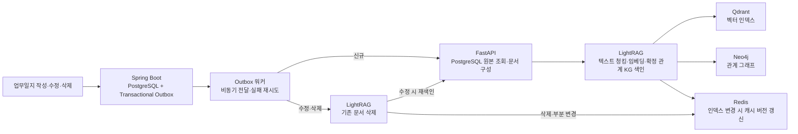
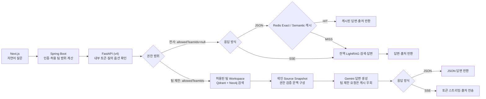

# ACODIAN — RAG AI Backend

## 📌 프로젝트 소개

**ACODIAN(AX-WMS)**은 본부·사업부·팀 단위의 업무일지를 관리하고, 축적된 기록을 자연어로 검색해 신뢰할 수 있는 근거와 답변을 제공하는 지능형 업무 관리 시스템입니다. **Next.js UI**, **Spring Boot API**, **FastAPI AI 서비스**의 3-Tier 모노레포 아키텍처로 구성되어 있습니다.

RAG 질의 파이프라인은 **LightRAG**의 **Qdrant 벡터 검색**과 **Neo4j 지식 그래프 탐색**을 사용합니다. 현재 v4의 팀 제한 질의는 인가된 팀별 전용 Workspace에서 검색하고, 색인 시 검증한 Source Snapshot으로 답변 문맥을 구성합니다. 전사 질의(`allowedTeamIds=null`)는 전역 Workspace를 사용합니다.

- **담당 범위**: RAG 질의·평가 파이프라인, 권한별 2단계 캐시, 증분 재색인 및 Spring Boot 연동
- **주요 기술**: `Python` · `FastAPI` · `LightRAG` · `Qdrant` · `Neo4j` · `PostgreSQL` · `Redis` · `Gemini` · `Spring Boot` · `Docker`

---

## 🏗️ 시스템 구조

### 1. 전체 시스템 아키텍처

---

### 2. 업무일지 색인·갱신 흐름

> [!NOTE]
> - **수정 동작**: 기존 문서를 삭제한 뒤 최신 원본을 다시 색인합니다.
> - **정합성 특성**: Outbox 패턴 기반의 비동기 처리이므로, DB 변경 시점부터 재색인 및 캐시 버전 갱신까지 즉시 일치하지 않는 일시적 불일치 구간이 존재합니다.

---

### 3. RAG 질의·답변 흐름 (v4)

> [!IMPORTANT]
> **v4 RAG 질의 파이프라인의 핵심 규칙**:
> 1. **팀 범위 격리**: 팀 제한 질의는 인가된 팀 ID에 해당하는 전용 Workspace에서 검색합니다. 전사 질의(`allowedTeamIds=null`)만 전역 Workspace를 사용합니다.
> 2. **팀 제한 문맥 구성**: 검색 후보의 원문·관계는 해당 팀 Workspace의 Source Snapshot에서 읽습니다. 질의마다 PostgreSQL 원본을 재조회하지 않으며, snapshot 최신성은 비동기 색인 반영 시점에 좌우됩니다.
> 3. **캐시 범위**: Redis Exact/Semantic 응답 캐시는 전사 JSON 질의에만 적용합니다. 팀 제한 JSON 질의와 SSE 질의는 캐시를 우회합니다.
> 4. **선택적 리랭킹**: TEI 리랭커는 설정 시 후보를 재정렬하며 기본값은 OFF입니다.
---

## 🚀 개인 기여 요약

| 문제 정의 | 해결 방안 및 정량적 결과 | 관련 PR |
| :--- | :--- | :---: |
| **검색·생성 지연** | • Qdrant·Neo4j 검색 병렬화, SSE 스트리밍 적용 • 로컬 단일 질의(`v4-033`) 기준 **완료 시간 8.30초 → 4.00초 (51.7%↓)**, **첫 응답 8.30초 → 2.45초 (70.5%↓)** | [#12](https://github.com/sunghun0917/acodian/pull/12) |
| **팀 간 데이터 노출 위험** | • v3 당시 PostgreSQL 원본 권한 재검증 후 LLM 문맥 구성 • 권한 범위별 Redis 2단계(Exact/Semantic) 캐시 구축 | [#13](https://github.com/sunghun0917/acodian/pull/13) [#21](https://github.com/sunghun0917/acodian/pull/21) |
| **수정·삭제 후 과거 답변 반환** | • 단일 문서 증분 재색인 파이프라인 구축 • Transactional Outbox 및 Redis 버전 무효화 적용 (**무효화 지연 39.96ms → 2.54ms**) | [#14](https://github.com/sunghun0917/acodian/pull/14) |
| **RAG 품질 검증 부재** | • 최종 V4 RAGAS 3대 지표 기반 정량 평가 파이프라인 구축 • Naive vs Mix 모드 및 선택적 리랭킹 영향 분석 | [#8](https://github.com/sunghun0917/acodian/pull/8) [#10](https://github.com/sunghun0917/acodian/pull/10) |

---

## 🛠️ 구현 상세와 엔지니어링 근거

### 1. 검색 병렬화 · SSE 스트리밍

- **문제 배경**:
  - LightRAG Mix 모드에서 벡터 검색과 그래프 탐색이 직렬로 대기하여 불필요한 대기 지연이 발생함.
  - LLM 생성이 완료될 때까지 사용자가 아무런 응답을 볼 수 없어 체감 지연(TTFT)이 심각함.
- **선택 및 구현**:
  - 상호 독립적인 그래프·벡터 조회를 `asyncio.TaskGroup`으로 묶어 병렬 실행하고, 임베딩 연산을 벡터 검색 태스크 내부로 이동.
  - 한쪽 태스크 예외 발생 시 나머지 태스크를 즉시 취소하는 안전한 수명주기 관리 보장.
  - 별도 FastAPI SSE 엔드포인트를 구현하고, 전체 요청 데드라인 및 클라이언트 연결 해제 핸들링 적용.
- **정량적 결과**:
  - V4 단일 질의 `v4-033` 로컬 측정 기준:
    - **전체 완료 시간**: `8,295ms` → **`4,004ms` (51.7% 감소)**
    - **첫 응답 시간 (TTFT)**: `8,295ms` → **`2,450ms` (70.5% 감소)**
    - *(※ 전체 트래픽의 지연 분포를 나타내는 수치는 아닙니다.)*
- **관련 코드 및 산출물**:
  - [병렬 검색 커밋](https://github.com/sunghun0917/acodian/commit/7b2e16a8) · [SSE 커밋](https://github.com/sunghun0917/acodian/commit/ed97985a) · [PR #12](https://github.com/sunghun0917/acodian/pull/12) · [측정 보고서](docs/ai/report/rag-optimization-and-evaluation-report.md)

---

### 2. 과거 v3 경로: 원본 권한 검증 · 2단계 캐시

> 아래 PostgreSQL 원본 재조회·삭제 상태 검증 및 권한별 Redis 캐시 설명은 과거 v3 경로의 구현과 측정입니다. 현재 v4의 팀 제한 질의는 팀별 Workspace와 Source Snapshot을 사용하고, 응답 캐시는 전사 JSON 질의에만 적용됩니다.

- **문제 배경**:
  - 여러 팀의 문서가 공존하는 단일 인덱스 특성상, 검색 결과를 그대로 LLM에 전달하면 권한 밖의 업무일지가 외부로 노출될 보안 위험 존재.
  - 동일/유사 질의 반복 시 매번 발생하는 검색 및 LLM API 토큰 비용 낭비.
- **선택 및 구현**:
  - 검색된 후보 문서를 **PostgreSQL 원본에서 재조회**하여 팀 권한 및 삭제 상태를 실시간 검증.
  - 인가된 본문만 LLM 문맥에 포함하도록 차단벽 형성.
  - 권한 범위별 격리된 **Redis Exact / Semantic 2단계 캐시** 및 Redis 장애 시 정상 조회로 이어지는 폴백 메커니즘 구축.
- **검증 결과**:
  - 권한 격리 보안 시나리오 5종 테스트 통과.
  - 실제 Gemini 질문 임베딩을 포함한 로컬 FastAPI HTTP 측정 (각 10회 중앙값):
    - **Exact HIT**: **`2.338ms`**
    - **Semantic HIT**: **`388.203ms`**
    - *(※ Spring API를 포함한 사용자 E2E 및 운영 SLA는 아닙니다.)*
- **관련 코드 및 산출물**:
  - [권한·캐시 커밋](https://github.com/sunghun0917/acodian/commit/e4659f39) · [PR #13](https://github.com/sunghun0917/acodian/pull/13) · [실임베딩 측정 커밋](https://github.com/sunghun0917/acodian/commit/6938ff21) · [PR #20](https://github.com/sunghun0917/acodian/pull/20) · [원시 표본](docs/ai/report/semantic-cache-real-embedding-raw.json)

---

### 3. 증분 재색인 · 캐시 최신성

- **문제 배경**:
  - 업무일지가 수정되거나 삭제된 이후에도 LightRAG 인덱스와 Redis 캐시에 과거 내용이 잔존하여 오래된 답변이 반환되는 데이터 불일치 발생.
- **선택 및 구현**:
  - 비용이 큰 전체 인덱스 재구축 대신, LightRAG의 **단일 문서 삭제 및 부분 재색인** 로직 채택.
  - 업무일지 CUD 트랜잭션과 동일 커밋 내에 **Transactional Outbox**를 기록하고, 워커가 지수 백오프로 재시도 처리.
  - 문서 삭제/삽입 등 부분 변경 시 Redis 글로벌 버전을 `INCR`하여 이전 캐시를 O(1)로 일괄 무효화.
- **정량적 결과**:
  - 1,000건 데이터 조건의 로컬 HTTP 벤치마크:
    - 무효화 처리 시간: 기존 `SCAN + DEL` **`39.96ms`** → `INCR` 기반 **`2.54ms`**
    - *(※ 글로벌 버전 방식은 빠르지만, 단일 문서 변경에도 전체 캐시가 무효화되는 트레이드오프가 있습니다.)*
- **정합성 범위**:
  - Outbox 패턴은 **비동기 최종 일관성(Eventual Consistency)**을 따릅니다. DB 커밋 시점부터 워커 반영 및 캐시 버전 갱신 전까지는 새 내용이 즉시 검색되지 않거나 이전 캐시가 반환될 수 있습니다.
- **관련 코드 및 산출물**:
  - [증분 재색인 커밋](https://github.com/sunghun0917/acodian/commit/a68fab56) · [부분 실패 방어 커밋](https://github.com/sunghun0917/acodian/commit/23eb59d7) · [PR #14](https://github.com/sunghun0917/acodian/pull/14) · [기술 보고서](docs/ai/report/worklog-rag-cache-and-reindex-report.md)

---

### 4. 최종 V4 RAGAS 평가 · 선택적 리랭킹

- **평가 기준**:
  - 합성 업무일지 **200건** 및 자연어 질문 **50문항**의 최종 채점 버전인 **V4**를 사용.
  - V3의 질문·응답을 바탕으로 작성자·팀을 묻는 18문항의 기준답변에 고유 ID를 보완한 버전 (검색 성능 개선으로 해석하지 않음).
  - 핵심 3대 지표: **Faithfulness(충실도)**, **Answer Relevancy(답변 관련성)**, **Context Recall(문맥 재현율)**. ([V3 질문 구성 커밋](https://github.com/sunghun0917/acodian/commit/7993e5a2), [V4 평가 커밋](https://github.com/sunghun0917/acodian/commit/37da0e24))

#### 📊 V4 정량 평가 비교표
| 평가 조건 | Faithfulness (충실도) | Answer Relevancy (관련성) | Context Recall (재현율) | 비고 |
| :--- | :---: | :---: | :---: | :--- |
| **Naive Baseline** | 0.9110 | 0.3015 | 0.3580 | 단순 벡터 검색 |
| **LightRAG Mix Baseline** | **0.9396** | 0.8316 | 0.6307 | 벡터 + 그래프 결합 |
| **LightRAG Mix + TEI 리랭커** | 0.8920 | 0.8496 | 0.6572 | 리랭킹 후보 재정렬 |
| **app.light.v4 (시작 시점, 44문항)** | 0.7603 | **0.9033** | **0.8428** | 2026-10-15 · reranker OFF |

> [!NOTE]
> - 이전 Naive/Mix/Reranker 결과와 `app.light.v4`는 파이프라인·모델·프롬프트·검색 조건이 달라 통제된 A/B 비교가 아니며, 점수 차이를 개별 변경의 인과 효과로 해석하지 않습니다.
> - 표의 각 행은 관계 부재 질문 6개를 제외한 **Main Overall 44문항 평균**입니다. (관계 부재 답변이 Answer Relevancy 0점 처리되는 왜곡을 방지하기 위해 분리 집계). ([V4 기본 평가](docs/ai/evaluation/v4/results-ragas-gemini-3.8-flash-20260929/report.md) · [V4 리랭커 평가](docs/ai/evaluation/v4/results-ragas-reranker-v4-mix-only-20260930/report.md))
> - 실제 `app.light.v4`의 **전체 50문항 점수**: Faithfulness **`0.7682`**, Answer Relevancy **`0.8961`**, Context Recall **`0.8617`**
> - *(※ V4 결과는 실행 중 코드 변경이 감지된 `source_changed` 상태로, 평가 시작 시점 코드 기준이며 최신 작업 트리 전체의 결과를 대변하지 않습니다. [실행 보고서](docs/ai/evaluation/v4/results-current-v4-20261015/report.md) 및 [종합 분석 보고서](docs/ai/report/rag-optimization-and-evaluation-report.md) 참조)*

- **TEI 리랭킹 도입 여부 판단**:
  - TEI 리랭커 적용 시 Answer Relevancy와 Context Recall은 소폭 향상되었으나, **Faithfulness가 0.9396 → 0.8920으로 하락**.
  - 로컬 CPU 환경(50문항 기준)에서 평균 검색 시간이 약 **104.51초** 소요됨 (답변 캐시 OFF 조건).
  - **결론**: 충실도 저하 및 지연 비용 대비 이득이 크지 않아 **기본 경로에서는 리랭커를 비활성화(OFF)**하기로 결정함. ([구현 커밋](https://github.com/sunghun0917/acodian/commit/a394e2f7), [PR #10](https://github.com/sunghun0917/acodian/pull/10))

---

### 5. 권한 검증된 직접 의존관계 문맥

- **문제 배경**:
  - 권한 제한 RAG가 업무일지 본문만 LLM에 전달할 경우, 직접적인 선행업무 의존관계나 작성자 간 협업 구조에 관한 질의에 정확히 답하기 어려움.
- **선택 및 구현**:
  - 선행-후행 양쪽 업무의 접근 권한이 모두 확인된 **직접 관계(Direct Dependency)**만을 선별하여 작성자·팀·태그 정보와 함께 LLM 문맥에 추가.
  - 문맥 크기 폭증을 막기 위해 확장량 상한선을 설정하고, 기존 텍스트 캐시와 별도의 네임스페이스로 분리.
  - *(※ 다중 홉 및 역방향 탐색은 복잡도 관리를 위해 의도적으로 제외함)*
- **관련 코드 및 산출물**:
  - [관계 문맥 커밋](https://github.com/sunghun0917/acodian/commit/467d68d0) · [캐시 분리 커밋](https://github.com/sunghun0917/acodian/commit/091f7869) · [PR #21](https://github.com/sunghun0917/acodian/pull/21)

---

## 🧪 검증 및 테스트

- **AI 서비스 단위/통합 테스트**:
  - 사전 준비: [환경 설정 가이드](ai/AGENTS.md) 참조
  - 실행 명령어: `cd ai && python -m pytest tests -q`
  - 결과: 2026-10-15 로컬 실행 기준 **458 passed, 2 skipped** (※ `ai/tests/` 범위 검증이며, 로컬 Qdrant payload-index 경고 1건 발생. 실제 Gemini/Redis 벤치마크나 Spring API E2E를 대체하지 않습니다.)
- **세부 실험 및 벤치마크 보고서**:
  - [RAG 응답 시간 최적화 보고서](docs/ai/report/rag-optimization-and-evaluation-report.md)
  - [V4 RAGAS 기본 평가 결과](docs/ai/evaluation/v4/results-ragas-gemini-3.8-flash-20260929/report.md)
  - [V4 리랭커 평가 결과](docs/ai/evaluation/v4/results-ragas-reranker-v4-mix-only-20260930/report.md)
  - [실임베딩 캐시 성능 측정 보고서](docs/ai/report/semantic-cache-real-embedding-benchmark.md)
  - [재색인 및 캐시 무효화 기술 보고서](docs/ai/report/worklog-rag-cache-and-reindex-report.md)
