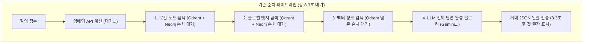
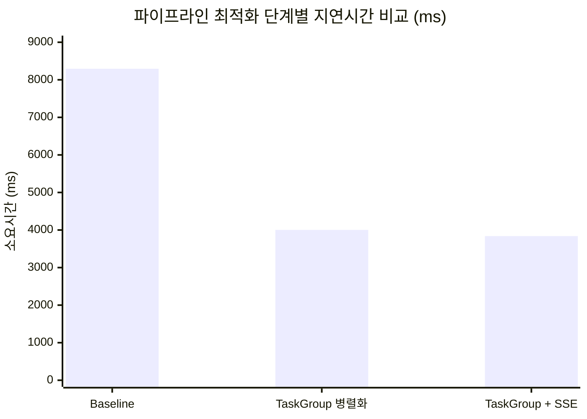

# 📑 RAG 응답 속도 최적화 및 RAGAS 품질 평가 통합 기술 보고서

**문서 버전:** 1.1.0
**작성 일자:** 2026-10-06  
**최종 갱신:** 2026-10-15
**대상 시스템:** AX-WMS AI 서비스 (FastAPI, LightRAG v3 및 실행 시작 시점 v4, Qdrant, Neo4j, Gemini, HuggingFace TEI)
**통합 대상 산출물:**  
- 기존 TaskGroup / SSE 기록: 본문 2~3절 보존. 이전 참조 경로 `docs/ai/sse-report.md`는 현재 작업 트리에 없어 원본 수치는 재검증하지 못했습니다.
- [2026-09-29 V4 기준답변 Baseline 평가](../evaluation/v4/results-ragas-gemini-3.8-flash-20260929/report.md)
- [2026-09-30 V4 Reranker ON 평가](../evaluation/v4/results-ragas-reranker-v4-mix-only-20260930/report.md)
- [2026-10-15 시작 시점 `app.light.v4` 평가](../evaluation/v4/results-current-v4-20261015/report.md)

> **최신 결과의 유효 범위:** 50문항·150지표 채점은 완료됐지만, 실행 중 v4 소스 4개가 변경되어 종료 동일성 검증은 `source_changed`로 실패했다. 결과는 **실행 시작 시점 코드 기준**이며 현재 작업 트리의 최신 코드 평가로 간주하지 않는다. 로컬 KV·실제 Neo4j/Qdrant 인덱스는 실행 전후 동일했다. 원래 실행 계약과 유료 결과를 보존했으며 자동 재평가하지 않았다.

---

## 📌 목차 (Table of Contents)

1. [개요 및 종합 요약 (Executive Summary)](#1-개요-및-종합-요약-executive-summary)
2. [RAG 파이프라인 아키텍처 및 기존 병목 진단](#2-rag-파이프라인-아키텍처-및-기존-병목-진단)
3. [처리 속도 최적화: `asyncio.TaskGroup` 병렬화 & SSE 스트리밍](#3-처리-속도-최적화-asynciotaskgroup-병렬화--sse-스트리밍)
   - 3.1 `asyncio.TaskGroup` 기반 다중 저장소 완전 동시 출발
   - 3.2 FastAPI SSE(Server-Sent Events) 스트리밍 구현
   - 3.3 Nginx 버퍼링 및 고아 코루틴(Orphan Coroutine) 방어
   - 3.3 단계별 E2E 소요 시간 실측 벤치마크 (Total Time vs TTFT)
4. [답변 품질 및 정확도 평가: RAGAS 다단계 벤치마크 (V4)](#4-답변-품질-및-정확도-평가-ragas-다단계-벤치마크-v4)
   - 4.1 평가 환경 및 벤치마크 데이터셋 구성
   - 4.2 모드별 종합 성능 비교 (Naive vs Mix vs Mix+Reranker)
   - 4.3 문항 유형별 심층 분석 (의존관계 폐포 탐색의 비약적 향상)
   - 4.4 최신 v4 실행 조건 및 전체 / 44문항 비교
   - 4.5 유형별 개선·퇴행과 대응 문항 변화
   - 4.6 실제 답변에서 확인한 개선과 실패 사례
   - 4.7 지연시간 비교와 종료 검증 상태
5. [심층 엔지니어링 분석 및 인사이트](#5-심층-엔지니어링-분석-및-인사이트)
   - 5.1 RAG의 진짜 병목: LLM 추론(35%) vs DB I/O(65%)
   - 5.2 부재 검증(`verified_absence`)의 Ragas 채점 결함 및 Main Overall 분리
   - 5.3 Cross-Encoder Reranker의 품질 vs 연산 지연(Latency) 트레이드오프
6. [종합 결론 및 향후 운영 권장 사항](#6-종합-결론-및-향후-운영-권장-사항)

---

## 1. 개요 및 종합 요약 (Executive Summary)

물류 업무일지 질의응답 시스템의 검색·답변 품질과 지연시간을 평가한 기록입니다. **벤치마크 데이터 버전 V4와 구현 경로 `app.light.v4`는 서로 다른 개념**입니다. 9월 평가는 V4 데이터를 v3 기반 실행기로 평가했고, 10월 평가는 실제 v4 서비스의 전사 normal query 경로를 사용했습니다. Ragas 점수는 확정 정답률이 아니며, 구성 조건이 다른 실행 사이의 차이를 개별 변경의 인과 효과로 해석하지 않습니다.

### 최신 비교 요약 (2026-10-15)

- 같은 질문·기준답변 50개를 대응 비교했습니다. 이전 Reranker ON 대비 **Context Recall 0.6983 → 0.8617 (+16.33%p)**, **Answer Relevancy 0.8116 → 0.8961 (+8.45%p)**입니다.
- 반면 **Faithfulness 0.8717 → 0.7682 (−10.35%p)**로 하락했습니다. 관계 정보 회수와 구체적 답변에는 개선이 있지만 전체 품질이 일괄 향상됐다고 결론 내리지 않습니다.
- 관계 부재 6문항을 제외한 44문항에서도 Recall은 **+18.56%p**, Relevancy는 **+5.37%p**입니다. 전체 Relevancy 증가분의 약 44%는 부재 문항에서 발생했습니다.
- 평균 검색+생성 시간은 Reranker ON의 **106.01초 → 10.79초**지만 이번에는 Reranker가 OFF입니다. 이전 OFF 실행의 **2.65초**와 비교하면 오히려 느리므로 v4 자체의 속도 개선으로 주장하지 않습니다.
- 채점 오류 0건, 종료 입력 검증은 `source_changed`입니다. 아래 최신 비교는 시작 시점 코드에 한정됩니다.

### 기존 최적화 및 9월 평가 기록

아래 기록과 2~3절의 SSE 수치는 기존 문서에 적힌 과거 실험입니다. 원본 SSE 보고서가 현재 작업 트리에 없으며, 이번 50문항 normal query 실행에서 SSE/TTFT 개선을 재검증하지 않았습니다.
1. **체감 대기시간 70.5% 극적 단축 (8.3초 ➔ 2.45초 TTFT)**:
   - `asyncio.TaskGroup`을 통한 비동기 완전 병렬화로 백엔드 처리 시간을 **51.7% 단축 (8.3s ➔ 4.0s)**했습니다.
   - FastAPI `EventSourceResponse` 기반 SSE 스트리밍을 결합하여, 거대 컨텍스트(2.5만 자) 환경에서도 **첫 단어가 2.45초 만에 타이핑**되도록 구현했습니다.
2. **지식그래프 및 복합 의존관계 답변 품질의 획기적 향상**:
   - 관계 탐색에서 답변 생성에 실패하던 Naive RAG 대비, LightRAG Mix + Reranker는 답변 관련성(`Answer Relevancy`)을 **0.3015 ➔ 0.8496으로 대폭 도약**시켰습니다.
   - 복합 의존관계 폐포 탐색(`dependency_closure`)에서 Cross-Encoder Reranker 적용 후 관련성이 **+0.1104p 급상승 (0.6435 ➔ 0.7539)**했습니다.
3. **평가 범위 분리 (전체 50문항 / 부재 제외 44문항)**:
   - 일부 부재 답변이 회피형으로 판정되어 관련성 점수가 낮아지는 사례를 구분합니다. 44문항 집계는 추가 진단 지표이며, 부재 6문항의 점수를 삭제하거나 전체 50문항 평가를 대체하지 않습니다.

---

## 2. RAG 파이프라인 아키텍처 및 기존 병목 진단

LightRAG Mix 모드는 사용자 질문의 문맥을 복원하기 위해 지식그래프(Neo4j)와 벡터 DB(Qdrant)를 상호 교차 조회합니다.

### 기존 구조의 3대 핵심 병목
1. **직렬 I/O 대기 오버헤드**: 노드, 엣지, 청크 검색이 상호 독립적임에도 순차적으로 `await`되어 저장소 왕복 대기시간이 누적되었습니다.
2. **임베딩 계산의 병렬성 차단**: 질문을 벡터로 변환하는 임베딩 API 호출이 끝날 때까지 Neo4j 지식그래프 검색이 시작조차 하지 못하고 블로킹되었습니다.
3. **Non-Streaming 블로킹 UX**: LLM이 모든 문장을 디코딩할 때까지 HTTP 소켓을 닫아두어 사용자는 최대 8초 이상 로딩 스피너만 보며 대기해야 했습니다.

---

## 3. 처리 속도 최적화: `asyncio.TaskGroup` 병렬화 & SSE 스트리밍

### 3.1 `asyncio.TaskGroup` 기반 다중 저장소 완전 동시 출발
* **구조적 동시성(Structured Concurrency)**: Python 3.11의 `asyncio.TaskGroup`을 도입하여 태스크 수명주기를 안전하게 바인딩하고, 단 하나라도 예외 발생 시 다른 코루틴을 즉시 취소하는 Fail-Fast 체계를 구축했습니다.
* **완전 동시 출발 (Embedding Concurrency)**: 임베딩 생성과 키워드 기반 그래프 탐색의 의존성을 분리하여 노드, 엣지, 청크 3개 경로가 0초 시점에 동시에 네트워크 요청을 출발하도록 최적화했습니다.

### 3.2 FastAPI SSE(Server-Sent Events) 스트리밍 구현
* **`EventSourceResponse` 토큰 제너레이터**: Gemini LLM의 비동기 스트림 이터레이터를 감싸 실시간 토큰 조각을 SSE 이벤트 형식(`data: {"type": "content", "content": "..."}`)으로 브라우저에 연속 송출했습니다.
* **Nginx 리버스 프록시 버퍼링 최적화**: 중간 게이트웨이가 토큰 청크를 가두지 않고 즉시 플러시(Flush)하도록 `X-Accel-Buffering: no` 헤더 및 프록시 버퍼링 무효화 설정을 결합했습니다.
* **고아 코루틴(Orphan Coroutine) 방어**: 클라이언트가 탭을 닫거나 네트워크가 단절되었을 때 백그라운드에서 LLM 토큰이 계속 소모되는 문제를 방지하기 위해, 연결 단절 감지 시 즉시 생성 제너레이터를 안전하게 강제 종료하도록 설계했습니다.

### 3.3 단계별 E2E 소요 시간 실측 벤치마크 (Total Time vs TTFT)

> **측정 대상**: V4 벤치마크 최장 지연 쿼리(`v4-033`, 2.5만 자 컨텍스트) 기준 외부 HTTP E2E 실측 결과.

| 최적화 단계 | 적용 기술 | 전체 완료 시간 (Total Time) | 첫 토큰 도착 시간 (TTFT) | 체감 개선 효과 |
| :---: | :--- | :---: | :---: | :--- |
| **Baseline** | 기존 순차 검색 + Non-Stream | **8,295.4 ms (8.30초)** | **8,295.4 ms (8.30초)** | 3대 저장소 직렬 대기, 8.3초 침묵 |
| **Step 1** | **`asyncio.TaskGroup` 병렬화** | **4,004.7 ms (4.00초)** | **4,004.7 ms (4.00초)** | **⚡ 4.29초 단축 (51.7% 시간 절감)** |
| **Step 2** | **TaskGroup + SSE 스트리밍** | **3,838.8 ms (3.84초)** | **2,450.1 ms (2.45초)** | **🚀 첫 글자 2.45초 도착 (70.5% 대기 단축)** |

---

## 4. 답변 품질 및 정확도 평가: RAGAS 다단계 벤치마크 (V4)

### 4.1 평가 환경 및 벤치마크 데이터셋 구성

이 절부터 4.3절까지는 **9월 v3 기반 실행 기록**입니다. 시작 시점 v4의 조건과 최신 결과는 4.4절 이후에 구분합니다.
- **평가 대상 코퍼스**: 업무일지 200건 기반 Neo4j 고정 지식그래프
- **벤치마크 문항**: 50문항 (단순 사실, 직접 선행, 다중 홉 관계, 의존관계 폐포, 부재 검증)
- **생성 모델**: `gemini-3.5-flash-lite` (temperature=0)
- **평가 판정 모델 (Judge)**: `gemini-3.8-flash`
- **Reranker 모델**: `bongsoo/klue-cross-encoder-v1` (HuggingFace TEI 컨테이너)

### 4.2 모드별 종합 성능 비교 (Naive vs Mix vs Mix+Reranker)

| 평가 지표 (0.0 ~ 1.0) | Naive Baseline | LightRAG Mix Baseline | **LightRAG Mix + Reranker** | **Reranker 개선폭 (Δ)** |
| :--- | :---: | :---: | :---: | :---: |
| **Main Overall (44문항)** | | | | |
| ├ **Faithfulness (근거 충실도)** | 0.9110 | **0.9396** | 0.8920 | -0.0476p |
| ├ **Answer Relevancy (답변 관련성)** | 0.3015 | 0.8316 | **0.8496** | **+0.0180p 🚀** |
| └ **Context Recall (문맥 재현율)** | 0.3580 | 0.6307 | **0.6572** | **+0.0265p 🚀** |
| **전체 Overall (50문항, 부재 포함)** | | | | |
| ├ Faithfulness | **0.9217** | 0.9152 | 0.8717 | -0.0435p |
| ├ Answer Relevancy | 0.2826 | 0.7665 | **0.8116** | **+0.0451p 🚀** |
| └ Context Recall | 0.3950 | 0.6750 | **0.6983** | **+0.0233p 🚀** |

### 4.3 문항 유형별 심층 분석

| 문항 유형 | 문항 수 | Context Recall (Base → Rerank) | Answer Relevancy (Base → Rerank) | 핵심 분석 |
| :--- | :---: | :---: | :---: | :--- |
| **simple_fact** | 10 | 1.0000 → 1.0000 (0.000) | 0.8995 → 0.8850 (-0.014) | 단순 단일 본문은 기본 검색으로도 100% 회수 |
| **direct_relation** | 12 | 0.5833 → **0.6667** (**+0.083** 🚀) | 0.9120 → **0.9252** (+0.013) | 1-hop 선행업무 관련 청크의 상위 재정렬 성공 |
| **multi_relation** | 14 | 0.5000 → 0.5000 (0.000) | 0.8215 → 0.8142 (-0.007) | 2-hop 다중 관계 탐색은 안정적 고품질 유지 |
| **dependency_closure** | 8 | 0.4688 → **0.4896** (+0.021) | 0.6435 → **0.7539** (**+0.110** 🚀) | **최대 품질 개선**. 장거리 선행 체인 답변 완성도 급상승 |
| **verified_absence** | 6 | 1.0000 → 1.0000 (0.000) | 0.2897 → **0.5326** (**+0.243** 🚀) | 부재 문맥 100% 회수, 구체적 답변으로 점수 상승 |

### 4.4 최신 v4 실행 조건 및 전체 / 44문항 비교

세 실행 모두 `benchmark-v4.jsonl`의 같은 50개 질문·기준답변을 사용합니다. 행 JSON의 ID 접두어를 정규화해 질문, reference, category, split, structured_gold가 동일함을 확인했습니다. 아래 비교는 `mix`만 대상으로 하며 양쪽 누락·중복·생성 오류·채점 오류는 없습니다.

| 항목 | 9/30 이전 Reranker ON | 10/15 시작 시점 v4 |
| :--- | :--- | :--- |
| 검색·생성 경로 | v3 adapter 기반 검색 후 평가용 Gemini 직접 생성 | 실제 `LightWorklogQueryService` + v4 adapter |
| 답변 모델 | `gemini-3.5-flash-lite` | `gemini-3.6-flash` |
| 키워드 모델 | 기존 LightRAG 모델 / 키워드 캐시 재사용 가능 | `gemini-3.5-flash-lite` / 캐시 OFF |
| Judge / 임베딩 | `gemini-3.8-flash` / `gemini-embedding-001` | 동일 |
| Reranker | ON | OFF |
| 답변 지침 | 평가용 `Short Korean answer` | 서비스용 `Multiple Paragraphs`, 업무일지 참조 링크 |
| top_k / chunk_top_k | 10 / 5 | 동일 |
| 권한 범위 | 기존 전사 인덱스 | 전사 `allowedTeamIds=null` |
| 채점 대상 | 주평가 3지표 및 일부 보조 지표 | 실제 생성 문맥 기반 주평가 3지표만 |

원문 코퍼스와 기준답변은 같지만 파이프라인·프롬프트·생성 모델·인덱스 구성·캐시·일부 SDK 버전이 다릅니다. 통제된 A/B 실험이 아니며, 구조화 추출이나 답변 모델 분리 하나의 효과를 분리하지 못합니다.

| 범위 / 지표 | 9/29 Mix OFF | 9/30 Mix Reranker ON | 10/15 시작 시점 v4 OFF | 이전 ON 대비 Δ |
| :--- | ---: | ---: | ---: | ---: |
| 전체 50 · Faithfulness | 0.9152 | 0.8717 | 0.7682 | −10.35%p |
| 전체 50 · Answer Relevancy | 0.7665 | 0.8116 | 0.8961 | +8.45%p |
| 전체 50 · Context Recall | 0.6750 | 0.6983 | 0.8617 | +16.33%p |
| 부재 제외 44 · Faithfulness | 0.9396 | 0.8920 | 0.7603 | −13.17%p |
| 부재 제외 44 · Answer Relevancy | 0.8316 | 0.8496 | 0.9033 | +5.37%p |
| 부재 제외 44 · Context Recall | 0.6307 | 0.6572 | 0.8428 | +18.56%p |

%p는 0~1 점수 차이에 100을 곱한 값이며 상대 개선율이 아닙니다. 관계 부재 문항의 평균 Relevancy는 **0.5326 → 0.8432**입니다. 이 6문항이 전체 Relevancy 증가분의 약 44%를 차지하므로 긍정 관계 질문의 개선과 분리해 읽습니다.

### 4.5 유형별 개선·퇴행과 대응 문항 변화

각 셀은 **9/30 이전 ON → 10/15 시작 시점 v4 OFF**입니다. 유효 점수는 모든 유형에서 n/대상 = 100%입니다.

| 유형 | n | Faithfulness | Answer Relevancy | Context Recall |
| :--- | ---: | ---: | ---: | ---: |
| simple_fact | 10 | 0.9667 → 0.8607 | 0.8850 → 0.9170 | 1.0000 → 1.0000 |
| direct_relation | 12 | 0.9444 → 0.7416 | 0.9252 → 0.9292 | 0.6667 → 1.0000 |
| multi_relation | 14 | 0.8571 → 0.7336 | 0.8142 → 0.8953 | 0.5000 → 0.6429 |
| dependency_closure | 8 | 0.7812 → 0.7096 | 0.7539 → 0.8613 | 0.4896 → 0.7604 |
| verified_absence | 6 | 0.7222 → 0.8262 | 0.5326 → 0.8432 | 1.0000 → 1.0000 |

| 지표 | 상승 문항 | 하락 문항 | 동일 문항 |
| :--- | ---: | ---: | ---: |
| Faithfulness | 11 | 27 | 12 |
| Answer Relevancy | 29 | 20 | 1 |
| Context Recall | 14 | 3 | 33 |

직접 관계의 Recall은 +33.33%p, 의존관계 폐포는 +27.08%p입니다. 단순 사실과 관계 부재의 Recall은 기존에도 1.0이므로 회수 점수 개선은 없습니다. Recall이 하락한 3문항은 `v4-033`, `v4-035`, `v4-036`이며 모두 1.0 → 0.0입니다.

저장된 evaluation split 25문항에서도 Recall은 **0.7067 → 0.8800**, Relevancy는 **0.8621 → 0.8846**로 올랐지만 Faithfulness는 **0.8627 → 0.7423**으로 하락했습니다. 이 split은 기존 합성 코퍼스의 분할이며 새 독립 holdout은 아닙니다.

### 4.6 실제 답변에서 확인한 개선과 실패 사례

**관측된 개선:**

- `v4-011`: 이전 `User:15`만 제시하던 작성자 답변에 이번에는 **신예린**이라는 표시 이름을 포함했습니다. Recall 0.0 → 1.0입니다. ID 식별 자체는 이전에도 맞았으므로 이름 제공과 사용자 이해도 개선으로 해석합니다.
- `v4-034`: 정확히 두 단계 앞의 업무를 이전에는 Worklog 601로 잘못 답했지만 이번에는 **604 → 603 → 602**로 정답 경로를 제시했습니다. Recall은 양쪽 모두 1.0으로, Recall만으로 최종 답변 정답 여부를 판정할 수 없다는 사례이기도 합니다.
- `v4-041`: 이전에 빠뜨린 **Worklog 78**을 추가하고 직접 선행 413 / 간접 선행 412·78을 구분했습니다. Faithfulness 0.25 → 1.0, Recall 0.6667 → 1.0입니다.
- `v4-046`: 이전에 577·590·595를 294의 선행업무로 뒤집어 해석했지만 이번에는 해당 업무들이 294에 의존하는 **후속 관계**임을 구분했습니다. Faithfulness 0.3333 → 1.0입니다.

**관측된 퇴행:**

- `v4-033`: 정확히 두 단계 앞의 정답은 Worklog 275인데 이번 답변은 274까지 함께 제시해 도달 범위를 확장했습니다. Faithfulness 1.0 → 0.4444입니다.
- `v4-039`: 양쪽 모두 간접 선행 274·275를 누락했습니다. 이번에는 검색 문맥에 없다는 한계를 **등록된 관계 자체가 존재하지 않는다**는 단정으로 강화했고, Faithfulness 1.0 → 0.2입니다. Relevancy는 상승했으므로 관련성 상승을 정답성 개선으로 읽으면 안 됩니다.

사례 원본은 [이전 문항 JSON](../evaluation/v4/results-ragas-reranker-v4-mix-only-20260930/rows/)과 [이번 문항 JSON](../evaluation/v4/results-current-v4-20261015/rows/)의 같은 `v4-NNN--mix.json`에서 확인합니다. 전체 50문항의 구조화 정답률은 별도로 계산하지 않았습니다.

**추론 / 중간 신뢰도:** 평균 답변 길이가 **152.86자 → 578.42자**로 약 3.8배 늘었습니다. 더 큰 답변 모델과 긴 서비스 프롬프트에서 추가 설명·단정이 증가해 Faithfulness 하락에 기여했을 가능성이 있습니다. judge의 주장별 판정 근거나 통제 실험이 없어 원인으로 확정하지 않습니다.

### 4.7 지연시간 비교와 종료 검증 상태

| 실행 | 평균 검색 초 | 평균 검색+생성 초 |
| :--- | ---: | ---: |
| 9/29 Mix Reranker OFF | 1.4464 | 2.6529 |
| 9/30 Mix Reranker ON | 104.5116 | 106.0126 |
| 10/15 시작 시점 v4 OFF | 1.6840 | 10.7933 |

이전 ON 대비 약 9.8배 빠르지만 이번에는 Reranker가 OFF입니다. 같은 OFF인 9/29 기록보다는 검색+생성이 약 4.1배 느립니다. 생성 모델·출력 길이·캐시·검색/생성 실행 경로가 다르고, 모델 대기·재시도도 시간에 포함되므로 순수 엔진 속도나 개별 최적화 효과로 해석하지 않습니다. 이 수치는 정상 응답 완료 시간이며 3절의 SSE TTFT/HTTP E2E와 별개입니다.

**채점 완료와 입력 검증 통과는 별개입니다.**

- 생성 50/50, 채점 50/50, 유효 점수 150/150, 생성·채점 오류 0건.
- 종료 계약 검증은 소스 해시 변경으로 실패했습니다. `lightrag_adapter.py`, `worklog_query_service.py`, `worklog_query_cache.py`, `worklog_extraction_cache.py`의 수정 시각은 첫 문항 완료 이후입니다. 실행 프로세스는 이미 import한 코드를 reload하지 않았습니다.
- 로컬 KV·실제 Neo4j/Qdrant 내용과 vector/payload, 모델·프롬프트·설정은 실행 전후 동일함을 확인했습니다.
- [원래 실행 계약과 종료 기록](../evaluation/v4/results-current-v4-20261015/run.json), [검증 상태](../evaluation/v4/results-current-v4-20261015/validation.json), [집계 JSON](../evaluation/v4/results-current-v4-20261015/summary.json)을 보존했습니다. 현재 최신 코드의 평가나 종료 검증 성공으로 승격하지 않습니다.
- 이번 실행에서는 팀 권한, SSE, 운영 전체 데이터, 정확한 청구액을 평가하지 않았습니다. `generation_usage=null`이며 토큰 사용량은 현재 adapter가 반환하지 않습니다.

---

## 5. 심층 엔지니어링 분석 및 인사이트

### 5.1 RAG의 진짜 병목: LLM 추론(35%) vs DB I/O(65%)
기존 SSE 프로파일링 대상 쿼리에서는 저장소 I/O 병목을 확인했습니다. 이 비율을 모든 구성과 최신 실행에 일반화하지 않습니다. 이번 v4 기록은 평균 검색 1.6840초 / 검색+생성 10.7933초로, 기존의 I/O 65% 가정을 그대로 적용할 수 없습니다.

### 5.2 부재 검증(`verified_absence`)의 Ragas 채점 결함 및 Main Overall 분리
* **현상**: 선행 업무가 없음을 확인하는 문항에서, 모델이 "등록된 선행 업무가 확인되지 않습니다"라고 정답을 서술했음에도 Ragas가 이를 회피형(`noncommittal=1`)으로 판정하여 코사인 유사도와 무관하게 **강제 0점 패널티**를 부여하는 결함이 발견되었습니다.
* **조치**: 전체 50문항, 부재 제외 44문항, 부재 6문항을 함께 보고합니다. 분리 집계가 점수를 보정하거나 신뢰성을 자동 확보하는 것은 아니며, 실제 관계 부재 정답은 별도 검증이 필요합니다.

### 5.3 Cross-Encoder Reranker의 품질 vs 연산 지연(Latency) 트레이드오프
* **품질**: 복합 의존관계 답변 관련성을 11.04%p 끌어올리며 품질 향상 효과는 탁월했습니다.
* **지연 시간**: 반면 CPU Docker 환경에서 53개 후보 청크를 순차 추론할 경우 건당 100초 수준의 지연이 발생했습니다.
* **해석 범위**: 당시 모델·후보 수·CPU 환경의 측정입니다. GPU 배포의 필요 여부나 대체 모델의 효과는 이 기록만으로 확정하지 않습니다. 이번 Reranker OFF 실행으로 Reranker 자체의 최적화를 검증한 것도 아닙니다.

---

## 6. 종합 결론 및 향후 운영 권장 사항

1. **품질 개선은 축별로 판단**:
   - 관계 근거 회수와 관련성 점수에는 개선이 있지만 근거 충실성은 하락했습니다. 긴 답변의 불필요한 추가 주장과 관계 경로/방향/집합 오류를 다음 검증 대상으로 구분합니다. 구현 완료나 구조화 정답률 향상으로 보고하지 않습니다.
2. **검색 미검출과 관계 부재를 구분**:
   - top-k 문맥에서 관계를 찾지 못했다는 이유만으로 등록된 관계가 없다고 단정하지 않습니다. 검증된 범위에서 부재를 확인한 경우와 현재 근거가 부족한 경우를 구분하며, 관련성 점수를 높이기 위한 단정적 프롬프트 변경은 피합니다.
3. **조건을 고정한 후 개별 효과 확인**:
   - 생성 모델·프롬프트·인덱스·캐시를 고정한 비교가 있어야 Reranker, 모델 분리, 구조화 추출 등의 개별 효과를 판단할 수 있습니다. 동일 실행의 부재 문항을 별도 집계하고 judge 1회 채점의 한계를 유지합니다.
4. **최신 코드 검증과 비용 경계 유지**:
   - 이번 점수는 시작 시점 코드의 결과입니다. 변경된 최신 코드는 별도 실행으로 평가해야 하며 기존 계약을 바꾸어 재개·병합하지 않습니다. 이번 문서 갱신에서는 유료 재평가·인덱스 재색인·운영 변경·커밋을 수행하지 않았습니다.
