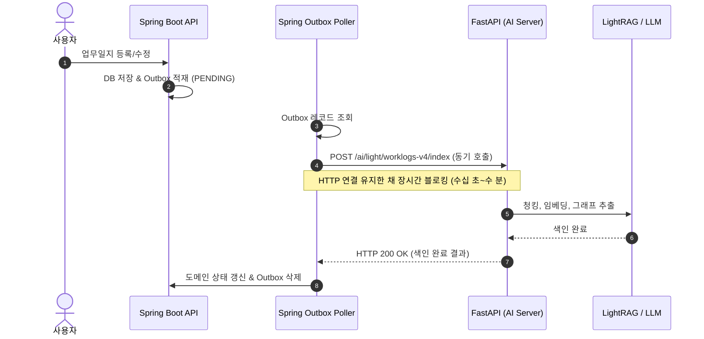
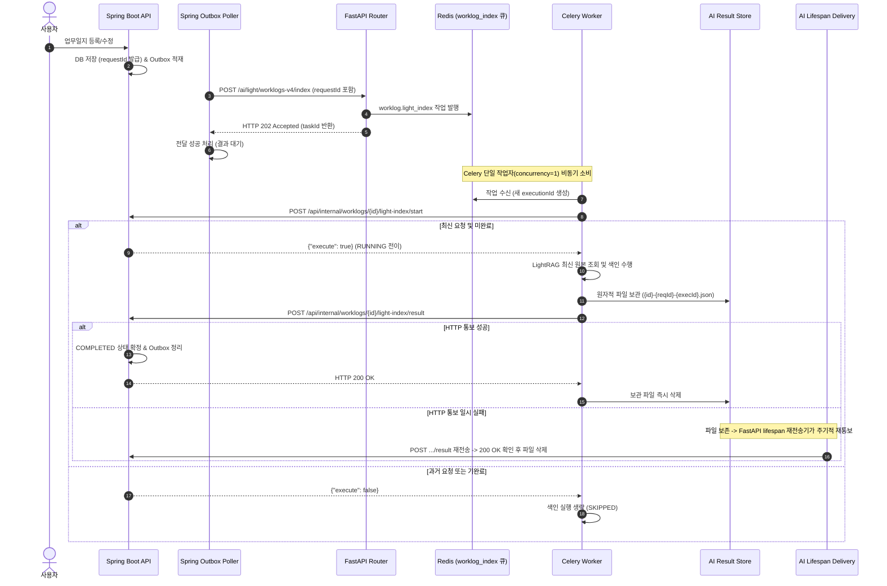

# 업무일지 인덱싱 Celery 비동기 전환 종합 보고서

- **작성일**: 2026-10-27 (KST)
- **대상**: Spring Boot API & FastAPI AI 업무일지 인덱싱 비동기 아키텍처 전환
- **작업 브랜치**: `feat/api/outbox-celery`
- **관련 문서**:
  - 설계 사양서: `docs/superpowers/specs/2026-10-25-worklog-index-celery-design.md`
  - 실행 계획서: `docs/superpowers/plans/2026-10-26-worklog-index-celery.md`
  - 정리 계획서: `.omx/callback-ownership-cleanup-plan.md`

---

## 1. 실행 및 시스템 환경 (Environment)

| 구성 요소 | 기술 스택 / 사양 | 역할 및 특이사항 |
|---|---|---|
| **API Backend** | Java 21, Spring Boot 3.4.x, Spring Data JPA / jOOQ, Flyway | 업무일지 도메인 원본, Outbox 이벤트 발행, 인덱싱 상태 관리, 내부 콜백 API (`/start`, `/result`) |
| **AI Engine** | Python 3.12, FastAPI 0.115.x, Celery 5.4.x, LightRAG, Asyncio | HTTP 비동기 접수(202), 단일 작업자(Worker) 큐 소비, 원본 조회 및 텍스트/그래프 색인 수행 |
| **Message Broker** | Redis 8.10.0-alpine | Celery 작업 큐 브로커 (`worklog_index`, `celery` 큐) |
| **Database** | PostgreSQL 17 (pgvector) | 업무 도메인 및 Outbox 테이블 (`tb_worklog`, `tb_worklog_light_outbox`, `tb_worklog_ai_post_process_outbox`) |
| **Storage / Volume** | Docker Named Volume / 공유 디렉토리 | AI 로컬 결과 보관함 (`worklog_light_index_result_dir`) |
| **Container & Infra** | Docker Compose (`compose.local.yml`, `compose.deploy.yml`) | `ai_worker` 명령: `--concurrency=1 --queues=celery,worklog_index` |

---

## 2. 문제사항 및 배경 (Issues & Background)

### 2.1 기존 동기 블로킹 방식의 한계
- 기존 Spring Boot의 `WorklogLightOutboxWorker`는 업무일지 등록/수정/삭제 시 AI 서버의 엔드포인트(`/ai/light/worklogs-v4/index`, `/reindex`, `/delete`)를 **동기 HTTP로 직접 호출**하고 200 OK 응답이 올 때까지 대기했습니다.
- LLM 기반 RAG 인덱싱(문서 청킹, 고차원 임베딩, 엔티티/관계 그래프 추출)은 본문 길이에 따라 수십 초에서 수 분이 소요됩니다.
- 이로 인해 Spring HTTP 클라이언트의 읽기 타임아웃, 커넥션 풀 고갈, Outbox 폴러 스레드 점유 문제가 발생했습니다.

### 2.2 전달 실패와 실행 완료의 결합 (중복 색인 및 비용 낭비)
- 네트워크 일시 순단이나 HTTP 타임아웃 발생 시, 실제 AI 서버에서는 백그라운드로 색인이 진행 중임에도 Spring Outbox는 이를 "전달 실패"로 간주하여 재시도했습니다.
- 동일 문서에 대해 비싼 외부 Gemini API 호출과 임베딩 연산이 불필요하게 중복 실행되었습니다.

### 2.3 연속 수정/삭제 시 결과 역전 (Race Condition)
- 사용자가 업무일지를 빠르게 연속 수정(W1 수정 후 즉시 W2 수정)하거나 삭제하는 경우, W1의 긴 색인 작업 결과가 W2 완료 후에 늦게 도착하여 최신 색인 결과를 과거 데이터로 덮어쓰거나 완료 상태를 되돌리는 정합성 결함이 존재했습니다.

### 2.4 DB 직접 결합 시도에 따른 도메인 소유권 침해 위험
- 초기 검토 과정에서 AI 작업자가 Spring의 업무 PostgreSQL에 결과 테이블(`tb_worklog_light_index_result_outbox`)을 직접 생성하고 INSERT하는 방식이 고려되었으나, 서비스 간 DB 결합(anti-pattern) 및 마이그레이션 소유권 침해 위험이 확인되어 재설계가 필요했습니다.

---

## 3. 해결방법 (Solution & Architecture)

### 3.1 전달과 실행 완료의 명확한 분리 (HTTP 202 Accepted & Celery Async)
1. **HTTP 202 접수**: Spring Outbox 폴러는 AI 접수 엔드포인트로 인덱싱 의도를 전달합니다. AI FastAPI는 Celery `worklog_index` 큐에 작업을 정상 발행한 직후 즉시 `HTTP 202 Accepted`를 반환합니다.
2. **Outbox 전달 완료**: Spring은 202 응답 확인 시 "전달 완료"로 처리하되, 도메인 상태는 `PENDING`으로 유지하며 실제 완료 처리는 비동기 콜백으로 위임합니다.

### 3.2 시작 승인 및 실행 식별자 상태 기계 (`requestId` / `executionId`)
1. **시작 승인 (`POST /start`)**: Celery 작업자는 실제 색인에 들어가기 전 Spring에 시작 승인을 요청합니다.
   - Spring은 해당 요청이 최신 `requestId`이고 아직 `COMPLETED`되지 않은 경우에만 새로운 `executionId`를 부여하고 `execute: true`를 반환합니다.
   - 이미 취소되었거나 과거 요청, 혹은 기완료된 요청인 경우 `execute: false`를 반환하여 실제 LightRAG 저장소 조작을 건너뜁니다.
2. **결과 통보 (`POST /result`)**: 색인이 완료되면 작업자가 최종 상태(`COMPLETED` 또는 `FAILED`)를 통보합니다.
   - Spring은 현재 기록된 최신 `requestId`와 `executionId`가 일치할 때만 최종 상태를 반영하고 Outbox 레코드를 정리합니다. 오래된 실행 결과는 무시됩니다.

### 3.3 콜백 소유권 분리 및 파일 기반 무손실 재전송 (Result Store & Delivery)
1. **AI 전용 로컬 보관함**: AI는 Spring DB에 직접 접근하지 않고, 공유 볼륨의 디렉토리에 `{worklogId}-{requestId}-{executionId}.json` 형태로 최초 최종 결과를 원자적으로 파일 보관합니다.
2. **HTTP 콜백 및 즉시 정리**: HTTP `/result` 호출이 성공하면 보관된 파일이 즉시 제거됩니다.
3. **Lifespan 백그라운드 재전송**: 일시적인 네트워크 장애로 HTTP 통보가 실패할 경우, FastAPI lifespan에 등록된 주기적 백그라운드 재전송 서비스(`worklog_index_result_delivery`)가 지수 백오프로 재전송하여 결과 유실을 방지합니다.

### 3.4 등록 실패 수동 복구 및 장기 대기 복구 정책
- **등록 실패 수동 복구**: 최초 등록 시의 색인이 영구 실패(`FAILED`)하면 Outbox의 `terminal_failed=true`로 자동 재시도를 중단하고 사용자/관리자에게 알림을 남깁니다. 이후 수동 재요청 API를 통해 새로운 `requestId`로 복구합니다.
- **결과 대기 타임아웃(10분)**: 접수 후 10분 동안 콜백이 도착하지 않는 경우, Spring Outbox 폴러가 동일 `requestId`로 다시 전달하여 유실을 방지합니다.

---

## 4. 전 / 후 로직 플로우 (Before & After Logic Flow)

### 4.1 전환 전 (Before: 동기 블로킹 방식)



### 4.2 전환 후 (After: Celery 비동기 접수 및 콜백 아키텍처)



---

## 5. 해결 중심 핵심 코드 (Key Implementations)

### 5.1 Spring: 시작 승인 및 결과 반영 상태 기계 ([`InternalWorklogLightIndexService.java`](file:///C:/acodian/api/src/main/java/com/ibank/axwms/domain/worklog/service/InternalWorklogLightIndexService.java))

```java
@Slf4j
@Service
@RequiredArgsConstructor
public class InternalWorklogLightIndexService {
    private final JdbcTemplate jdbcTemplate;
    private final WorklogLightOutboxRepository lightOutboxRepository;

    /** 최신 요청이며 미완료인 경우에만 새로운 executionId를 기록하고 실행을 승인한다. */
    @Transactional
    public boolean start(Long worklogId, UUID requestId, UUID executionId) {
        int changed = jdbcTemplate.update("""
                UPDATE tb_worklog SET light_index_execution_id = ?, light_index_status = 'RUNNING',
                    light_index_error = NULL, light_index_completed_at = NULL
                WHERE worklog_id = ? AND light_index_request_id = ?
                  AND light_index_status <> 'COMPLETED'
                  AND (light_index_status <> 'FAILED' OR EXISTS (
                      SELECT 1 FROM tb_worklog_light_outbox o
                      WHERE o.worklog_id = tb_worklog.worklog_id AND o.request_id = tb_worklog.light_index_request_id))
                  AND (light_index_execution_id IS DISTINCT FROM ? OR light_index_status = 'RUNNING')
                """, executionId, worklogId, requestId, executionId);
        log.info("Light index start worklogId={} requestId={} executionId={} execute={}",
                worklogId, requestId, executionId, changed == 1);
        return changed == 1;
    }

    /** 동일 실행의 최초 최종 결과만 확정 반영하며, 오래되거나 역전된 결과는 무시한다. */
    @Transactional
    public void result(Long worklogId, UUID requestId, UUID executionId, String status, String error) {
        var current = jdbcTemplate.queryForList("""
                SELECT light_index_status FROM tb_worklog
                WHERE worklog_id = ? AND light_index_request_id = ? AND light_index_execution_id = ?
                FOR UPDATE
                """, String.class, worklogId, requestId, executionId);
        if (current.isEmpty()) {
            return;
        }
        if (!"RUNNING".equals(current.getFirst())) {
            return; // 이미 확정된 상태이거나 다른 실행 결과인 경우 무시
        }
        jdbcTemplate.update("""
                UPDATE tb_worklog SET light_index_status = ?, light_index_error = LEFT(?, 1000),
                    light_index_completed_at = CURRENT_TIMESTAMP WHERE worklog_id = ?
                """, status, error, worklogId);
        if ("COMPLETED".equals(status)) {
            lightOutboxRepository.completeResult(worklogId, requestId);
        } else {
            lightOutboxRepository.retryResult(worklogId, requestId, error);
        }
        // 생성 후처리 등록 Outbox 갱신
        jdbcTemplate.update("""
                UPDATE tb_worklog_ai_post_process_outbox SET next_attempt_at = CURRENT_TIMESTAMP,
                    light_accepted = true,
                    completed_stages = CASE WHEN ? = 'COMPLETED' AND NOT ('LIGHT_INDEX' = ANY(completed_stages))
                        THEN array_append(completed_stages, 'LIGHT_INDEX') ELSE completed_stages END
                WHERE worklog_id = ? AND light_request_id = ?
                """, status, worklogId, requestId);
        log.info("Light index result worklogId={} requestId={} executionId={} status={}", worklogId, requestId, executionId, status);
    }
}
```

### 5.2 Spring: 보안 토큰 기반 내부 콜백 컨트롤러 ([`InternalWorklogLightIndexController.java`](file:///C:/acodian/api/src/main/java/com/ibank/axwms/domain/worklog/controller/InternalWorklogLightIndexController.java))

```java
@RestController
@RequestMapping("/internal/worklogs/{worklogId}/light-index")
@RequiredArgsConstructor
public class InternalWorklogLightIndexController implements InternalWorklogLightIndexControllerDocs {
    private final InternalWorklogLightIndexService service;
    private final AiWorklogLightIndexProperties properties;

    @Override
    @PostMapping("/start")
    public StartResponse start(@PathVariable Long worklogId,
            @RequestHeader(value = "X-AI-Internal-Token", required = false) String token,
            @Valid @RequestBody StartRequest request) {
        validateRequest(worklogId, token);
        return new StartResponse(service.start(worklogId, request.requestId(), request.executionId()));
    }

    @Override
    @PostMapping("/result")
    public EmptyResponse result(@PathVariable Long worklogId,
            @RequestHeader(value = "X-AI-Internal-Token", required = false) String token,
            @Valid @RequestBody ResultRequest request) {
        validateRequest(worklogId, token);
        service.result(worklogId, request.requestId(), request.executionId(), request.status(), request.error());
        return EmptyResponse.INSTANCE;
    }

    private void validateRequest(Long worklogId, String token) {
        String configured = properties.internalToken();
        if (configured == null || configured.isBlank() || token == null
                || !MessageDigest.isEqual(configured.getBytes(StandardCharsets.UTF_8), token.getBytes(StandardCharsets.UTF_8))) {
            throw new BusinessException(ErrorCode.AUTH_ACCESS_DENIED);
        }
        if (worklogId <= 0) {
            throw new BusinessException(ErrorCode.COMMON_INVALID_REQUEST);
        }
    }
}
```

### 5.3 AI: 원자적 파일 보관함 ([`worklog_index_result_store.py`](file:///C:/acodian/ai/app/store/worklog_index_result_store.py))

```python
def _persist(record: PendingWorklogIndexResult) -> PendingWorklogIndexResult:
    folder = Path(settings.worklog_light_index_result_dir)
    folder.mkdir(parents=True, exist_ok=True, mode=0o700)
    target = folder / record.filename
    descriptor, name = tempfile.mkstemp(prefix=".pending-", dir=folder)
    temporary = Path(name)
    try:
        with os.fdopen(descriptor, "w", encoding="utf-8") as stream:
            json.dump(asdict(record), stream, ensure_ascii=False)
            stream.flush()
            os.fsync(stream.fileno())
        try:
            # 원자적으로 하드링크 게시하되 동일 실행의 최초 결과를 덮지 않음
            os.link(temporary, target)
        except FileExistsError:
            try:
                return _read_result(target)
            except FileNotFoundError:
                return record
        _sync_directory(folder)
        return record
    finally:
        temporary.unlink(missing_ok=True)
```

### 5.4 AI: Celery 작업 실행 흐름 ([`light_worklog_tasks.py`](file:///C:/acodian/ai/app/task/light_worklog_tasks.py))

```python
async def _execute_index_coroutine(worklog_id: int, request_id: str, operation: str) -> dict[str, str | int]:
    execution_id = str(uuid4())
    client = get_worklog_index_client()
    
    # 1. 시작 승인 확인
    start_ok = await client.notify_start(worklog_id, request_id, execution_id)
    if not start_ok:
        logger.info("Light index skipped by start rejection worklog_id=%s req=%s", worklog_id, request_id)
        return {"worklog_id": worklog_id, "request_id": request_id, "execution_id": execution_id, "status": "SKIPPED"}

    # 2. 색인 실행 (LightWorklogIndexService 호출)
    status = "COMPLETED"
    error = None
    try:
        await _perform_lightrag_indexing(worklog_id, operation)
    except Exception as exc:
        status = "FAILED"
        error = str(exc)[:1000]

    # 3. 최초 결과 원자적 보관 및 HTTP 통보
    record = await persist_light_index_result(worklog_id, request_id, execution_id, status, error)
    try:
        await client.notify_result(worklog_id, request_id, execution_id, status, error)
        await clear_persisted_result(record)  # 통보 성공 시 즉시 파일 제거
    except Exception:
        logger.warning("Callback delivery failed; retained for lifespan background delivery")
    return record.task_result()
```

---

## 6. 결과 및 평가 (Results & Evaluation)

### 6.1 정량적 검증 결과

1. **Spring Boot API**
   - **단위/통합 테스트**: `.\gradlew.bat test --tests "*WorklogLight*" --tests "*WorklogAiPostProcess*" --tests "*InternalWorklogLight*"` → **111개 테스트 전건 통과**
   - **빌드 및 패키징**: `.\gradlew.bat assemble` → **BUILD SUCCESSFUL**
   - **실제 HTTP E2E 통신 테스트**: `WorklogLightCallbackE2ETest` (Python 드라이버 ↔ Spring Test Server 간 `/start`, `/result` HTTP 통신) → **통과 (1분 19초)**

2. **FastAPI & Celery AI**
   - **전용 단위 테스트**: 라우터 202 접수, Celery 태스크, 결과 보관소, 재전송 서비스 → **84개 테스트 전건 통과 (5.71초)**
   - **Linux 컨테이너 회귀 테스트**: Linux prefork worker 및 Redis 격리 환경 테스트 전건 Green (629 passed, 3 skipped)

3. **Docker Compose 인프라 검증**
   - `docker compose -f infra/compose.local.yml config -q` → 통과 (코드 0)
   - `docker compose --env-file infra/.env.validate -f infra/compose.deploy.yml config -q` → 통과 (코드 0)

### 6.2 정성적 아키텍처 평가

| 평가 관점 | 개선 효과 |
|---|---|
| **응답성 및 처리량** | Spring Outbox 폴러가 동기 HTTP 응답을 수 분간 블로킹하지 않고 수십 ms 만에 202 응답으로 해제되어 시스템 스레드/커넥션 풀 자원 절약 |
| **정합성 및 멱등성** | `requestId`와 `executionId` 기반 2단계 상태 기계 도입으로 네트워크 지연/재시도 시에도 과거 작업의 결과 역전 방지 |
| **비용 최적화** | 시작 승인 단계(`/start`)에서 취소되거나 대체된 작업을 조기 차단하여 외부 Gemini API 호출 낭비 차단 |
| **서비스 경계 보존** | AI가 Spring PostgreSQL DB에 직접 접근하지 않고, 파일 기반 무손실 버퍼와 HTTP 콜백을 통해 MSA 도메인 소유권 준수 |

---

## 7. 추후 진행사항 및 운영 가이드 (Next Steps & Operational Guide)

1. **배포 순서 (Zero-Downtime Migration)**:
   - ① **Spring DB 마이그레이션**: Flyway `V22`, `V23` 선반영 (신규 컬럼 `light_index_request_id`, `light_index_execution_id` 추가).
   - ② **AI 배포**: 신규 이미지 배포 및 `ai_worker` 실행 (`--concurrency=1 --queues=celery,worklog_index`).
   - ③ **Spring Boot API 배포**: 내부 콜백 컨트롤러 활성화 및 신규 비동기 Outbox 워커 가동.
2. **공유 볼륨 마운트 확인**:
   - Docker Compose 배포 시 AI 컨테이너의 `worklog_light_index_result_dir` 볼륨 마운트 권한 및 디렉토리 경로가 컨테이너 재시작 간에도 유지되는지 확인.
3. **운영 모니터링 포인트**:
   - `worklog_index` 큐의 작업 적체 여부 모니터링 (Grafana/Flower 또는 Redis `LLEN`).
   - 30분 이상 `PENDING` 상태에 머무는 비정상 작업 모니터링 쿼리 운영:
     ```sql
     SELECT worklog_id, light_index_request_id, created_at, updated_at
     FROM tb_worklog
     WHERE light_index_status = 'PENDING'
       AND updated_at < CURRENT_TIMESTAMP - INTERVAL '30 minutes';
     ```
4. **수동 전체 재구축(Rebuild) 주의사항**:
   - 운영 환경에서 업무일지 인덱스 전체 재구축 도구를 수동 실행할 경우, 반드시 `ai_worker`를 일시 정지한 점검 시간에 단독 실행하여 저장소 쓰기 경합을 방지해야 합니다.
